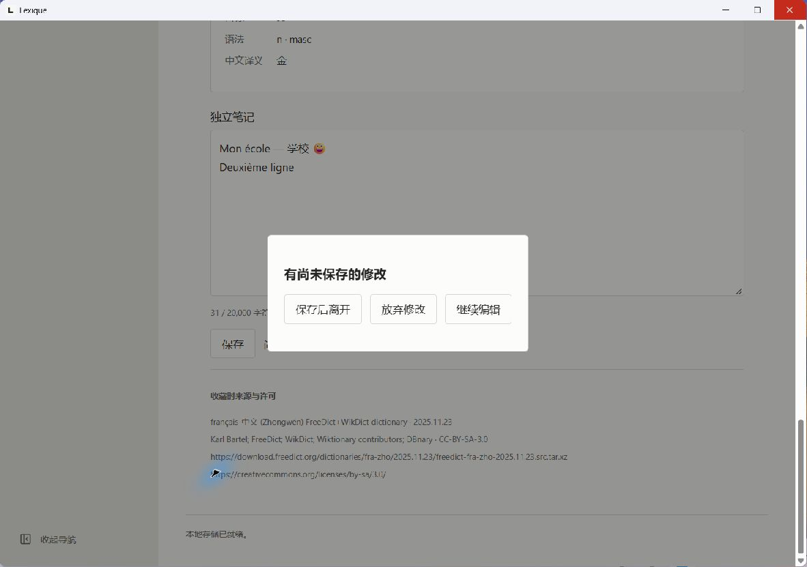
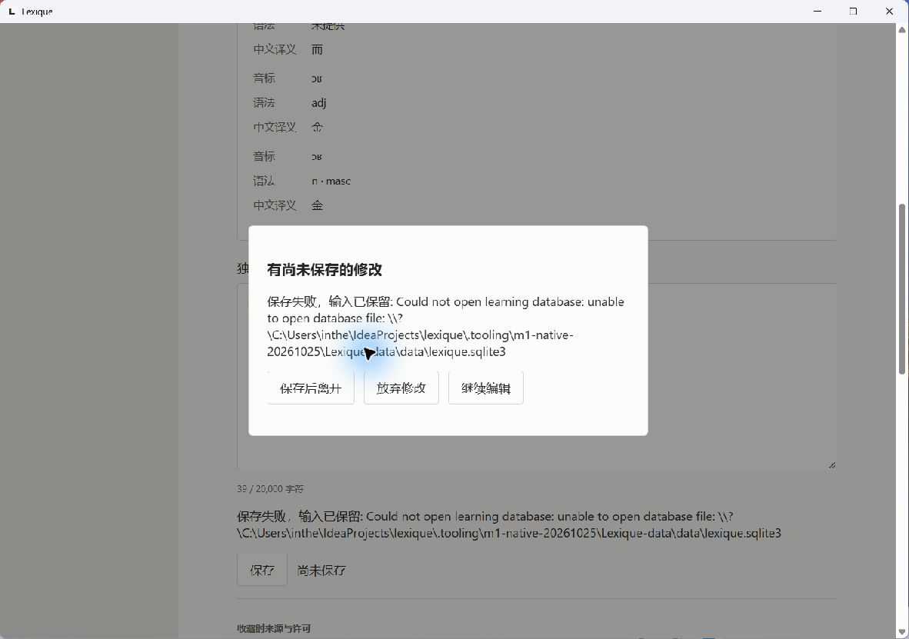
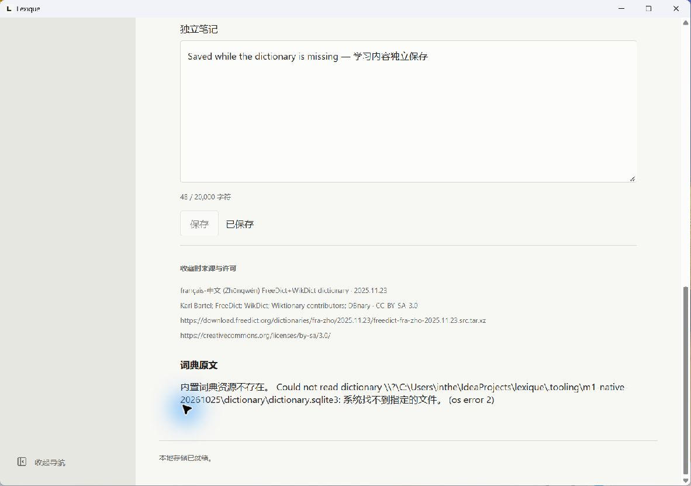
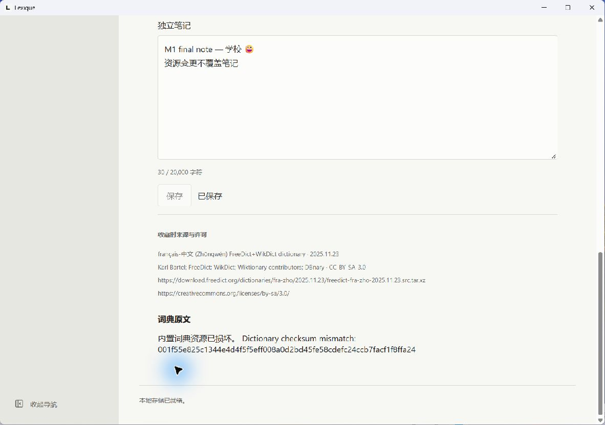
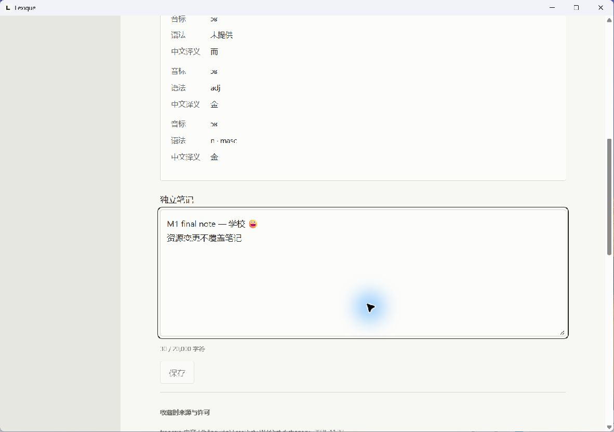

# M1 生词记录与笔记验证

日期：2026-10-25。规格：[issue #10](https://github.com/zardonc/lexique/issues/10)。实现包含三层展示、同标准词头一份收藏、独立笔记、显式保存、幂等重试、版本冲突、搜索排序和偏好恢复。本轮验证 Windows x64 开发构建，不表示四平台或正式发行验收完成。

## 环境与构建

| 项目 | 本轮结果 |
| --- | --- |
| 系统 | Windows 11 x64，NT 10.0.26300.0 |
| 工具 | Node.js 24.22.1、pnpm 11.25.0、Rust / Cargo 1.99.1 |
| 原生界面 | Tauri 2.12.5、WebView2 155.0.4283.62；内嵌前端生产构建 |
| 最终 debug EXE SHA-256 | `14667d78df7b1775069acb61bdaa3c102b783e9604e51164be301cb781c32eae` |
| 资源 | FreeDict / WikDict fra-zho 2025.11.23；10,947 条记录、10,777 个原始键 |
| 资源 SQLite SHA-256 | `11cdba7ed8fbdcd6f6a388586c11a181def517d840aae0baa6ef4a4ab5c55c51` |
| 用户库 | 增量迁移至 schema 2；测试副本独立位于 `.tooling/m1-native-20261025/Lexique-data/` |

使用仓库锁定版本，`pnpm install --frozen-lockfile` 通过。Cargo.lock 仅新增 NFC / NFD 所需的 `unicode-normalization` 与存储 crate 的直接依赖记录。原始资源、用户已有数据库和本轮开始前的文档编辑均保留。

原生 locked 构建的成功命令（仓库根目录，PATH 中需有 Python）：

```powershell
node apps/desktop/node_modules/@tauri-apps/cli/tauri.js build --debug --no-bundle -- --locked
```

`pnpm desktop:build --debug --no-bundle -- --locked` 和经 `pnpm exec` 转发的尝试均因参数分隔被 pnpm 11 消耗而报 `unexpected argument '--locked'`，未记为成功。直接调用已安装 CLI 后构建通过。本轮没有重打 release portable ZIP。

## 自动检查

| 命令 | 结果与边界 |
| --- | --- |
| `pnpm lint`、`pnpm typecheck`、`pnpm build` | 全部通过 |
| `pnpm test:e2e`（已安装 Edge） | 13 项通过：9 项生词本、2 项查词、2 项骨架；覆盖三语与手机宽度 |
| `pnpm rust:fmt`、`pnpm rust:check` | 全部通过 |
| `cargo clippy --locked --workspace --all-targets -- -D warnings` | 通过 |
| `pnpm rust:test:build` 后 `pnpm test:rust` | 15 项通过：2 项词典、4 项迁移、9 项生词存储；硬性 60 秒执行限制不变 |
| `pnpm test:resources` | 7 项通过，完整源记录及许可原文检查保留 |
| `pnpm wasm:build` 后 `node scripts/check-wasm.mjs` | 编译并实际装载通过，schema ABI 值为 2 |
| 上述原生 locked debug 构建 | 通过；最终二进制另做禁网重启回读 |

SQLite 检查使用真实 connection / 文件库，覆盖规范等价 Unicode 去重、大小写 / 重音 / 撇号身份差异、同头并发创建、响应丢失后创建与更新的重试不覆盖后来内容、版本冲突、空笔记 / 清空、Unicode 标量计数、六种稳定排序、字面搜索、只读及提交失败回滚、迁移保留旧数据和重新打开后的完整回读。浏览器 IPC 替身只证明交互及边界校验，不作为 SQLite 成功证据。

TDD 已先观察公开存储入口缺失和浏览器收藏入口缺失的失败，再实现通过。独立规格审查发现“响应丢失后把输入改回旧值会解除未保存保护”，新增回归先失败，修复后通过。独立规范审查发现 macOS 菜单 Quit / Cmd+Q 绕过窗口保护，现转入同一关闭路径，复查没有新增问题；下述 Dock Quit 缺口仍明确保留。

保留既有 Zod / Rollup 的两条注释解析警告、终端颜色环境警告，以及受限文件系统的增量缓存硬链接复制警告；未压低诊断或当作测试失败。首次受限环境 pnpm 下载的 DNS 失败不代表主机断网，正常执行环境安装成功。

## 真实原生禁网观察

沿用 [issue #8 的 AppContainer 方法](../issue-8/README.md#离线方法)，检查启动器与实际应用的 `TokenIsAppContainer` 为真、能力相同且无三项互联网 / 网络服务能力。每轮启动前 `1.1.1.1:443` 返回 WinError 10013，`example.com` DNS 返回 11001；没有修改防火墙、网络或系统安全设置。启动器保留到应用正常退出。本轮没有重复枚举 WebView 后代令牌。

测试操作由真实原生窗口完成，无 Vite、IPC 注入或替代持久化。所有笔记均为本轮合成数据。原始启动脚本、令牌报告与逐次数据库回读保存在忽略目录；可提交的精简结果见 [native-results.json](native-results.json)。

| 操作 | 实际结果 |
| --- | --- |
| 首次禁网查询 `or` | 3 条原文分别展示；只读摘要保留三条首译“而 / 金 / 金”，缺失语法明确显示未提供 |
| 打开收藏编辑器，尚未保存 | 数据库记录数仍为 0 |
| 保存空笔记 | 创建唯一 id 1，revision 1，笔记为空 |
| 输入多语言换行笔记，点标题栏关闭 | 显示三项选择；继续编辑保留输入；再次关闭选择保存后离开，提交 revision 2，进程退出 0 |
| 同等禁网重启 | 同一身份、词头、来源、摘要和笔记恢复；修改排序为词头正序并持久化 |
| 清空笔记并保存 | revision 3，笔记为空；摘要和来源未改变 |
| 暂移隔离副本用户库，再保存后离开 | 明确显示数据库打开失败，窗口及输入保留；恢复原库后选择放弃修改，进程退出 0，旧数据不变 |
| 暂移隔离副本词典后重启 | 原文报告资源缺失；笔记和摘要可读，另存笔记成功，revision 4 |
| 改动隔离副本资源字节后重启 | SHA-256 校验失败真实可见；原文不显示旧成功结果；仍能编辑保存笔记，revision 5，来源和摘要逐字节不变 |
| 恢复原词典，替换为最终 debug 构建，再禁网重启 | 排序为词头正序；笔记 `M1 final note — 学校 😀` 加换行中文恢复；正常关闭退出 0；数据库全行与重启前完全一致 |

资源变更验证通过追加字节触发固定资源校验失败；未加载新的有效词典版本，也没有实现摘要刷新。原始词典副本保留并恢复原哈希。最终用户库哈希与回读结果见 JSON。验证启动的原生程序、启动器和 Playwright 服务均已停止。

## 截图











截图中的词典摘要来自上述 FreeDict / WikDict 资源，Karl Bartel、FreeDict、WikDict、Wiktionary contributors、DBnary 归属及 CC-BY-SA-3.0 许可继续适用。原始来源和完整许可见 [资源说明](../../../resources/freedict-fra-zho-2025.11.23/README.md)；项目源码 MIT 不覆盖词典内容。

## 未验收与已知缺口

Windows x64 是唯一实际运行平台。macOS 专属菜单代码按当前安装的 Tauri API 复核，但没有在 macOS 编译或执行；Dock Quit 的框架终止路径仍可能绕过未保存提示，须在 macOS 验收前修复。Windows ARM64、macOS 两架构、远端 CI、release portable 重打、签名安装器和缺 WebView2 的干净机器均未在本轮验证。

没有新增删除、草稿、语法笔记、分类、FSRS、同步或服务集成。搜索在本地读取记录后匹配和排序，没有做大规模生词本性能验收；当前结果不宣称生产或四平台发布就绪。
