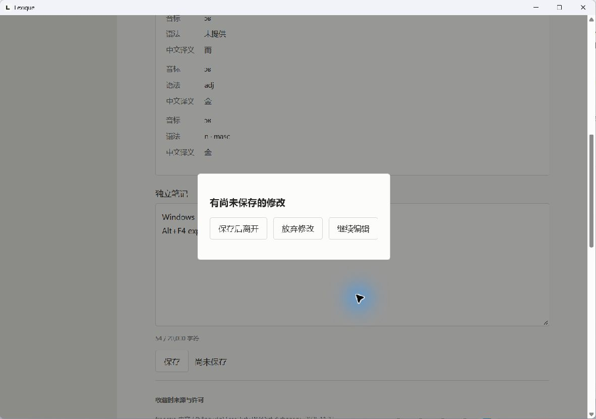
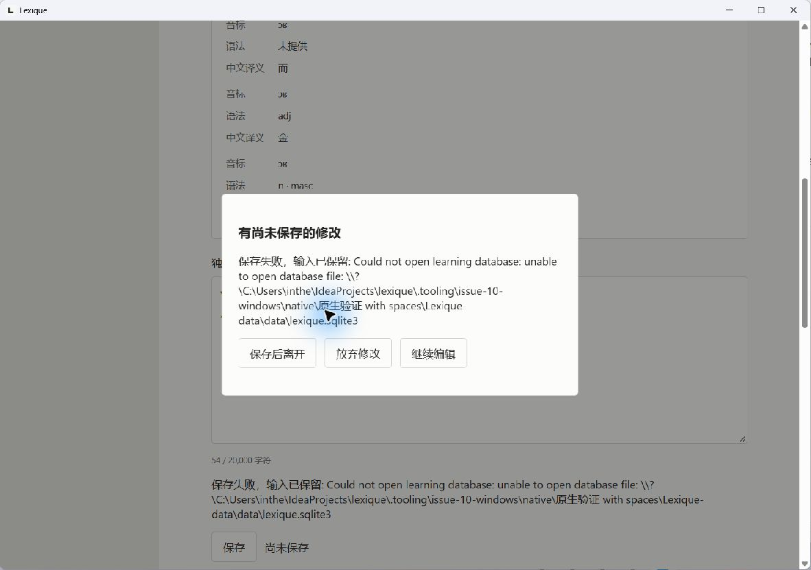
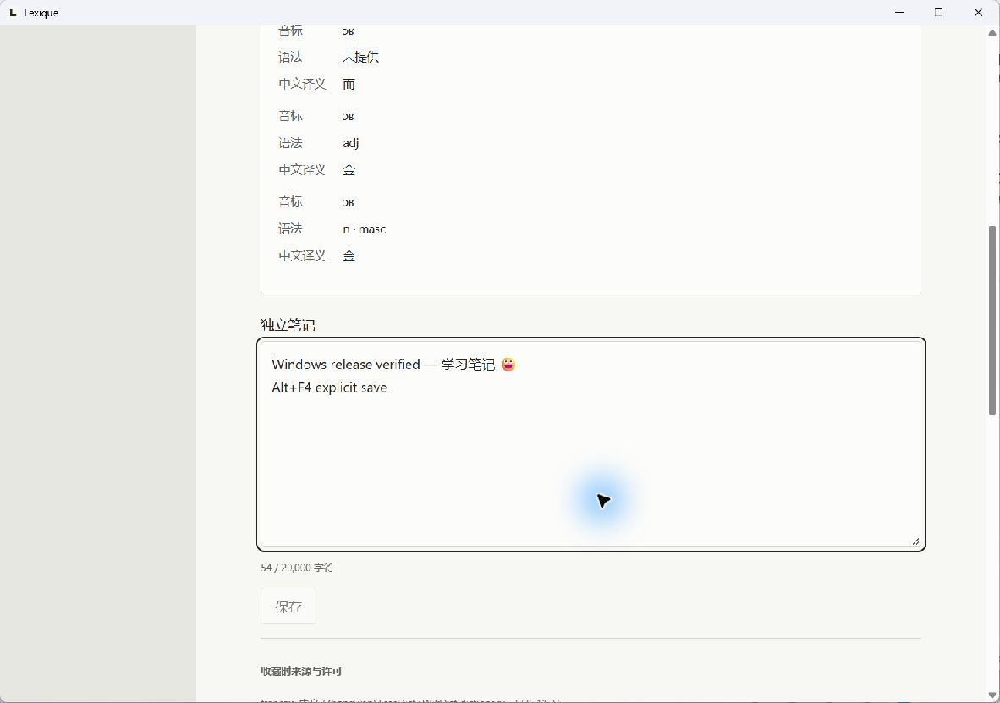

# Windows 构建与打包回归修复

日期：2026-10-25。接续 #10 复盘；本轮只修构建 / 打包工具及验证，不改变保存逻辑或 macOS 专属代码。必须由 macOS 执行的剩余工作统一为 [blocked 清单](../../macos-m1-blockers.md)。

## 修复与自动检查

旧公开入口 `pnpm desktop:build --no-bundle -- --locked` 已实际复现 `unexpected argument '--locked'`：pnpm 11 消耗转发的分隔符。现在 `scripts/build-desktop.mjs` 通过 Node 参数数组调用已安装 Tauri CLI，在最后一个进程边界追加 `-- --locked`，原生构建默认 locked；`desktop:portable` 复用同一入口。CLI 的非零退出码继续报告失败。

新增 `pnpm test:tooling`，不编译 Rust，只使用临时夹具：

- 2 项 Node 测试：从真实 pnpm 命令验证含空格参数与 Cargo 分隔符；原生 CLI 失败保持非零退出。
- 5 项 Python 测试：归档及逐项哈希回读、许可保留和 M1 说明、排除运行数据、已有目录 / ZIP / sidecar 拒绝覆盖、错误架构 / 非 PE 与资源校验失败时保留输入、独立输出不改旧交付。

新增检查已接入现有 CI：前端先检查构建参数，资源矩阵运行隔离打包测试，Windows portable 作业先运行完整工具测试再构建。本轮未推送或执行远端 CI；配置存在不记为远端通过。

打包脚本增加 `--output-dir`，用于保留旧交付的重复构建；包内说明现准确包含 M1 笔记，不再声称“不支持笔记”。不改变已有同名输出的拒绝覆盖规则。

## 本机结果

| 检查 | 结果 |
| --- | --- |
| `pnpm test:tooling` | 2 项 Node + 5 项 Python 通过 |
| `pnpm lint`、`pnpm typecheck` | 通过 |
| `pnpm test:e2e`，已安装 Edge | 13 项通过；Playwright 开发服务已停止 |
| `pnpm test:resources` | 7 项通过 |
| `pnpm rust:test:build` 后 `pnpm test:rust` | 15 项通过；硬性 60 秒执行限制不变 |
| `cargo check --locked --workspace --target aarch64-pc-windows-msvc` | Windows ARM64 编译通过；没有 ARM64 实机运行证据 |
| `pnpm desktop:portable --output-dir .tooling/issue-10-windows/portable` | locked release 与内嵌前端生产构建通过；10 个文件回读校验通过 |
| JS 语法、Python 预编译、差异与本地 Markdown 链接 | 通过 |

工具回归在实现入口之前先因缺少对应入口失败；原参数转发失败另有真实命令复现。Windows 11 x64、Node 24.22.1、pnpm 11.25.0、Rust 1.99.1、已有 WebView2 环境与 [首轮证据](README.md) 相同。保留 Zod / Rollup 注释、颜色环境等既有警告。普通沙箱的 Corepack 下载受 DNS 限制，使用正常执行环境的锁定 pnpm 进行实际检查。

## 新 release 产物

| 项目 | 值 |
| --- | --- |
| ZIP | `.tooling/issue-10-windows/portable/Lexique-0.1.0-windows-x64-portable.zip` |
| 字节 | 5,192,558 |
| ZIP SHA-256 | `3899777aa02f88976af23e6be7f0a53e1c9b4d826e9b6ab32fb7931b9f997ba4` |
| EXE SHA-256 | `2c5a0c8600d3cb5ec1d14789a5884d96aaeed18a94794e96161a3fb4764f7a92` |
| 原词典 SHA-256 | `11cdba7ed8fbdcd6f6a388586c11a181def517d840aae0baa6ef4a4ab5c55c51` |
| 原 `target/portable` ZIP SHA-256 | `0a48d529fc98c619a76e353faa661716b61c9894b99e68c728a65554b219c116`，与其原 sidecar 一致，本轮未覆盖 |

## 新 release 真实窗口

将新交付完整复制到含中文和空格的隔离目录，并只拷入首轮合成测试数据库，未使用真实用户学习数据。沿用首轮 AppContainer 启动器；两轮应用令牌与启动器一致，无互联网 / 网络服务能力，IP 连接被 WinError 10013 拒绝，DNS 返回 11001。未改变系统网络或安全设置，未重新枚举 WebView 后代令牌。

实际观察：旧记录 id 1、收藏时摘要 / 来源、旧笔记和词头正序偏好恢复；输入新的多语言换行笔记后，真实 Alt+F4 出现保存 / 放弃 / 继续编辑三项，继续编辑保留输入。暂移测试副本用户库，再点标题栏关闭并保存后离开，打开数据库失败时窗口与输入均保留；恢复原库后重试成功，revision 从 5 变为 6，正常退出 0。同等禁网重启，笔记 `Windows release verified — 学习笔记 😀` 与第二行 `Alt+F4 explicit save` 恢复，来源和摘要不变。再次输入合成文本，Alt+F4 选择放弃后退出 0；数据库整行、schema 2 和排序偏好与已保存结果完全一致，见 [精简回读](windows-release-results.json)。两轮原生程序及启动器均已退出。

截图中的词典内容继续适用 FreeDict / WikDict 的 CC-BY-SA-3.0 与既有归属，原始资源及许可说明见 [资源文档](../../../resources/freedict-fra-zho-2025.11.23/README.md)。合成记录回读、两轮令牌与进程报告保存在本地忽略目录 `.tooling/issue-10-windows/`。

本轮没有在 macOS 执行专属代码，没有 ARM64 实机、缺 WebView2 干净机器、签名 / 公证或完整离线核心发行验收。macOS Dock Quit 的风险保持 blocked；Windows 通过不能解除该平台阻塞。
