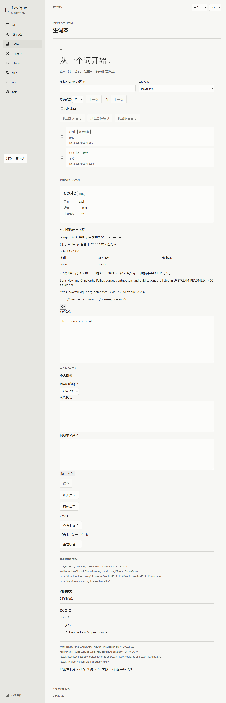

# Lexique 3.83 词频标记与只读资源

2026-11-08，[#57](https://github.com/zardonc/lexique/issues/57)。生词列表及已保存详情显示高／中／低／暂无词频，详情保留字幕语料、词性数值、来源与许可。Windows x64 原生查询、资源故障／恢复、重启及学习数据保持通过；三语／三主题文字与 4.5:1 对比度检查通过。

## 固定来源与统计

原作者 Boris New、Christophe Pallier 的 Lexique 3.83 完整 TSV、版本声明、CC BY-SA 4.0 法律原文和署名保存在[资源目录](../../../resources/lexique-3.83/README.md)。原 TSV 为 25,850,780 字节，压缩保存为 5,215,763 字节，解压后保持原始字节。来源与修改说明见 [provenance.json](../../../resources/lexique-3.83/provenance.json)。转换器采用独立 MIT 许可；源数据和派生 SQLite 保持 CC BY-SA 4.0。

以 `(NFC(lemme), cgram)` 去重，每组要求一致、有限且非负的 `freqlemfilms2`，跨词性只合计一次。保留重音及源拼写；精确原形优先，屈折词形仅在原表给出唯一词元时关联。缺值、非法、冲突、缺词性或不可靠关联均保留未知；明确零值属于低频。100／10 是产品边界，不推导 CEFR。

| 项目 | 结果 |
| --- | ---: |
| 原始行 | 142,694 |
| NFC 词元／词元与词性组 | 46,947／51,126 |
| 搜索词形／词形关联 | 125,653／135,267 |
| 歧义词形键 | 9,436 |
| 没有 `islem=1` 行的词元 | 3,385，全部保留 |
| 明确零值／未知词元 | 9,316／8 |
| 缺词性组／缺值／非法／组内冲突 | 8／0／0／0 |
| SQLite | 10,424,320 字节 |
| 转换 | 1.657 秒 |

八个缺词性的组保留数值及原因，整词合计为未知。详细计量与固定输入见 [report.json](report.json)。

## 原始样本核对

独立读取原 TSV，核对词性合计、去重及词形关系；[原形样本](raw-full-lemma-values.json)和[词形样本](raw-lookup-samples.json)保留原列值。

| 原始输入 | 查询结果 |
| --- | --- |
| `a priori` | ADV 1.04 + NOM 0.41 = 1.45 |
| `abaisser` | 多个屈折行的 4.93 只计一次 |
| `cote`／`côte`／`côté` | 8.48／35.16／285.99，重音保持区别 |
| `suis` | `suivre`／`être` 两词元，保持未知 |
| `étaient` | 可靠关联 `être`，AUX 8074.24 + NOM 100.69 + VER 32236.50 = 40411.43 |
| `a` | 精确词元 NOM 81.36 优先，不改为 `avoir` |
| `a contrario` | 已知零，低频 |
| `o` | 缺词性原值 0.01 与 NOM 57.07 保留，合计未知 |
| `œil` | 原表没有可靠匹配，保持未知 |

## 原生与界面

`frequency_lookup` 每批最多 100 个词头，共用一份验证后的只读 SQLite 快照。原生样本查询 16.7 ms，100 词批次 19.6 ms。前端只查询当前生词页及所选详情，迟到结果不覆盖新页；资源不可用时记录和笔记仍可编辑，重试只重新读取词频。请求与响应严格校验，schema 保持 17。

真实 SQLite 回读核对生词、两卡、评分进度／历史、选定音频及保护关系在资源丢失、损坏、恢复和正常重启前后相同。原生 WebView 拒绝外部请求，词频从随包文件读取；完整结果见 [native-results.json](native-results.json)。



三语及三主题都通过文字／对比度检查，代表性截图为[英文纯白](frequency-en-white.png)、[中文暖色](frequency-zh-sepia.png)和[法文深色](frequency-fr-dark.png)。

## 检查与开发包

| 命令／检查 | 结果 |
| --- | --- |
| `pnpm lint`、`pnpm typecheck` | passed |
| `pnpm desktop:build`（含前端 build） | passed，Windows x64 release |
| `pnpm test:e2e` | passed，171 项／55.9 秒 |
| `pnpm --filter @lexique/desktop exec playwright test e2e/frequency.spec.ts` | passed，17 项；最终分页／迟到失败／重试 3 项和三语／三主题 9 项分别通过 |
| `pnpm rust:fmt`、`pnpm rust:test:build`、`pnpm test:rust` | passed；预编译独立，执行保持 60 秒硬限 |
| `pnpm test:tooling` | passed；含五项词频转换及资源／通知不匹配打包失败路径 |
| 原生 `native-frequency-check.mjs` | passed；数值、来源、100 词批次、资源故障与重启 |
| `pnpm test:docs`、`git diff --cached --check` | passed；141 份文档／1,077 个本地链接，73 个本机材料目标按规则跳过 |

原生执行命令从 `apps/desktop/` 运行：

```sh
node e2e/native-frequency-check.mjs ../../target/pr23-native-speech-20261101 ../../target/release/lexique-desktop.exe ../../target/desktop-conjugation-v6-stats ../../target/desktop-frequency-v1 ../../target/issue-57/native-2
```

完整日志保存在忽略的 `target/issue-57/`。检查启动的开发服务和原生进程均已退出。

| Windows x64 开发交付 | ZIP 字节 | 解压后逻辑字节 | 回读验证文件 |
| --- | ---: | ---: | ---: |
| 普通 portable | 23,737,627 | 52,771,066 | 66 |
| 含已准入 Supertonic 3 的 portable | 184,834,656 | 294,493,426 | 1,128 |

两包的 `frequency/` 均有九份文件，共 15,675,380 逻辑字节，包含数据库、完整原始源、法律原文、署名、来源／修改说明和转换器。普通包位于 `target/issue-57/portable-1/`，含语音包位于 `target/issue-57/portable-speech-1/`；旧交付保持。构建／打包遇到损坏输入或通知时在创建新交付前失败，不覆盖学习数据。

规范与规格两轴审查均为零项发现，见[审查记录](review.md)。

## 限制

其他平台测试按用户要求暂缓。用户报告的干净系统通过已记录在 [#56](../issue-56/README.md)；本次新增词频不扩大该报告的覆盖。当前为依赖已有 WebView2 的未签名开发包，Lite 下载、完整默认词典／分级与八种正式发行物仍按 M5 验收。词频资源、派生颜色及测试截图不进入用户学习数据同步。
