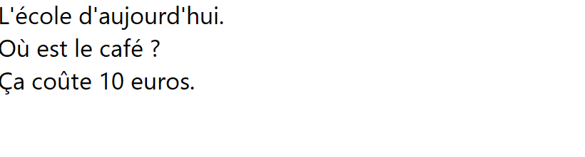
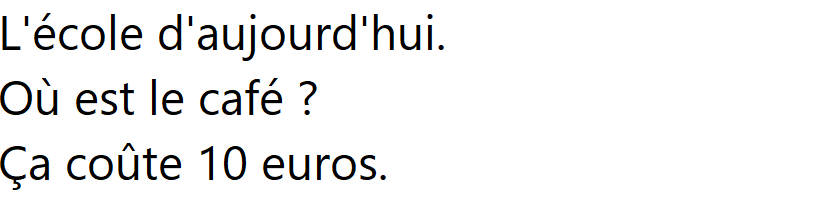

# 屏幕区域与图片法语 OCR（#59）

2026-11-09，Windows x64 的屏幕框选、PNG／JPEG 输入、本地法语 OCR 和翻译原文已接入。默认截图快捷键为 `Ctrl+Alt+Shift+O`，可在设置中独立更改并跨重启保存。框选后自动识别并保留截图预览；导入／粘贴图片由用户点击识别。文字进入翻译模块的可编辑原文，保留前 5,000 个 Unicode 字符，随后由用户明确选词查询离线词典。

## 原生矩阵

使用固定 Tesseract.js／core 7.0.0、法语 `fra` 与 XCap 0.9.9。实际 Windows WebView2 加载随程序提供的 worker、六份 WASM 核心和语言数据；外部 HTTP／HTTPS 请求被拒绝，运行中未产生外部请求。来源、完整通知、输入上限与独立性能样本见[资源准入](resource-probe.md)和[资源目录](../../../resources/tesseract-fra/README.md)。

| 显示器 | 物理原点／位图 | 缩放／实际 CSS 视口 | 约 820×220 的框选结果 |
| --- | --- | --- | --- |
| 主屏 | `(0,0)`／1,920×1,080 | 125%／1,536×864 | 820×221，通过 |
| 副屏 | `(-2520,0)`／2,520×1,680 | 175%／1,441×961 | 821×221，通过 |

原生指针在分数缩放下允许一物理像素舍入。拖动时立即保存截图像素坐标；视口改变不会重新解释起点。两屏均识别以下完整原文，并在明确查询 `école` 后显示真实词典释义。

```text
L'école d'aujourd'hui.
Où est le café ?
Ça coûte 10 euros.
```

八项原生检查全部通过：本地 PNG 识别、法文按钮框选与取消、英文主屏默认键框选、法文副屏自定义键框选、取词／截图快捷键冲突、Escape 取消、隐藏主窗口期间的关闭／未保存笔记保护，以及确认关闭后的快捷键和学习数据恢复。当前界面语言同时传到所有框选窗口的控件与原生标题。确认关闭的宿主进程退出码为 0；完整矩阵在 30.1 秒内完成，保留 60 秒硬超时。

重启前后逐项比较两份生词、一份评分进度／历史、两张卡、选定音频和保护关系，内容及音频字节保持一致；schema 仍为 17。截图及原文不自动持久保存、写入日志或同步。结果见[原生记录](native-results.json)、[运行版本](native-run-metadata.json)和[关闭生命周期](native-lifecycle.jsonl)。





## 检查命令

Windows 使用 PowerShell 7、pnpm 11.25.0 和 Rust 1.99.1。Python 使用 `C:/Soft/1A-Coding/PythonPortable/python/cpython-3.14-windows-x86_64-none`；浏览器使用固定 Chrome headless shell。

| 命令 | 结果 |
| --- | --- |
| `pnpm lint`、`pnpm typecheck` | passed |
| `pnpm test:e2e screen-capture.spec.ts` | passed，鼠标／键盘／拖动期间改变视口、英文／法文控件与空选区，5 项 |
| `pnpm test:e2e` | passed，完整 198 项，1.1 分钟；包括真实本地 WASM、取消／迟到、图片边界和 5,000 字截断 |
| `pnpm desktop:build --no-bundle` | passed，前端和 Windows x64 release，Cargo 保留 `--locked` |
| `pnpm rust:fmt` | passed |
| `pnpm rust:test:build` → `pnpm test:rust` | passed，预编译后执行 148 项，60 秒硬限 |
| 桌面库预编译 → `pnpm test:desktop:lib` | passed，8 项；包含图像／区域入口和失败关闭恢复保护 |
| `python -B -X utf8 -m unittest discover -s scripts -p test_package_portable.py -v` | passed，9 项 |

原生命令从 `apps/desktop/` 执行：

```powershell
node e2e/native-ocr-check.mjs ../../target/pr23-native-speech-20261101 ../../target/release/lexique-desktop.exe ../../target/desktop-conjugation-v6-stats ../../target/desktop-frequency-v1 ../../target/issue-57/native-2/Lexique-data ../../target/issue-59/native-16
```

完整日志保留在忽略目录 `target/finish-issues/`：`overlay-final-browser.log`、`overlay-locale-release.log`、`overlay-native-ocr.log`、`rust-final.log`、`overlay-desktop-lib.log` 和 `ocr-package-green.log`。测试宿主、框选窗口、合成源窗口及浏览器服务均已停止。

## Windows x64 开发包

```powershell
python -B -X utf8 scripts/package_portable.py --output-dir target/issue-59/portable-reviewed-20261109 --speech-bundle target/pr23-native-speech-20261101/speech --speech-encoder target/pr23-native-speech-20261101/speech/opusenc.dll --speech-sources target/issue-59/encoder-sources
```

`Lexique-0.1.0-windows-x64-portable-speech.zip` 为 194,456,669 字节，解压文件逻辑总量 304,886,238 字节。1,196 个 ZIP 文件、完整清单及回读校验通过。程序包含本次原生矩阵的同一 release；语音输入经原有 stage 校验，词典、变位、词频及语音材料一并保留。

OCR 运行库与语言数据嵌入程序，不另存重复副本；`ocr-notices/` 保留 68 份来源／法律文件，包括 42 份固定原生依赖原文和浏览器 worker、Buffer、ieee754 等通知。完整数据和六份核心随完整版及 Lite 提供，Lite 仍仅省去内嵌 TTS 模型。

SHA-256：`4e1b3d815f4e72d40ebbf3be9dda11c3f3280bc063b9f949b4fbdd4077bc0596`。

## 限制

其他平台执行按用户要求暂缓，macOS 的屏幕录制权限拒绝／撤销／恢复及系统退出矩阵尚未实测。在线翻译服务按 M4 接入；WebView2 PDF 无系统选择 API，可主动粘贴或使用 OCR。此次为 Windows x64 开发包，M5 的四目标完整版／Lite、缺少 WebView2 的首装禁网、签名和公证仍按各自门槛验收；既有用户干净系统与语音试听报告保留。
