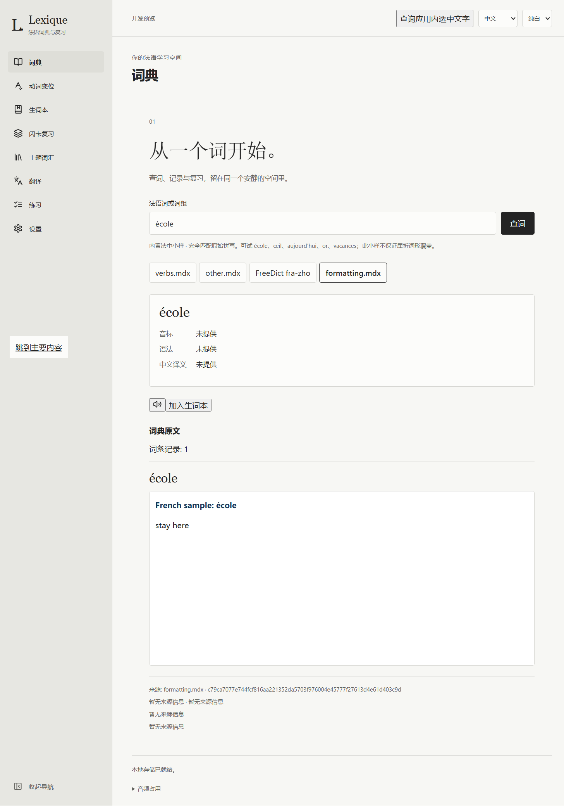
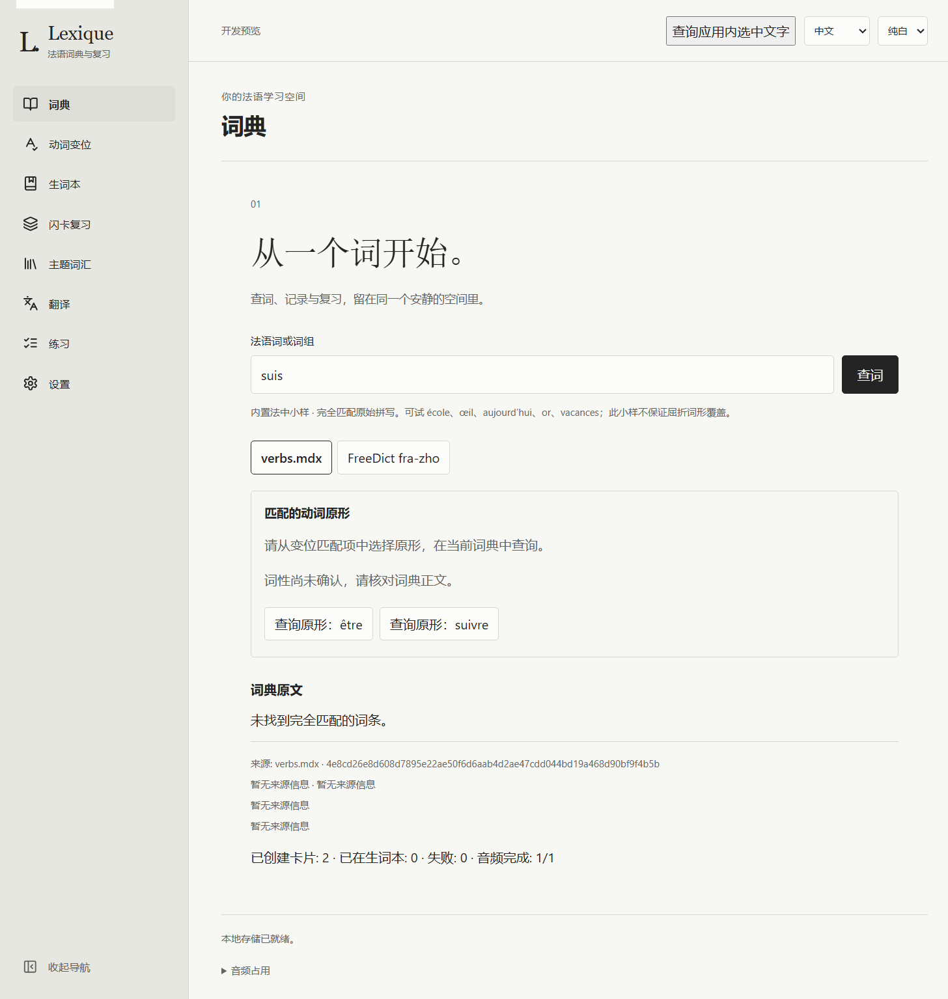

# 多 MDX 标签与动词原形关联（issue #9 D1／D3）

2026-11-09，用户批准的 [D1／D3 范围](../../lookup-enhancement-slices.md)已接入 Windows x64：设置导入及保存词典顺序，按标签读取隔离正文；已收录动词的普通／代词式原形由用户明确选择，并在当前词典核对目标。默认资源仍为已准入的 FreeDict 小样。

## 实现与数据边界

- 初次按保存顺序尝试，选中首个读取成功的词典；空结果仍保留该标签。其他正文点击标签后读取，单个来源的缺失、损坏、不支持和超限独立显示。
- 用户 MDX 保留于学习库旁的 `dictionaries/mdx-N.mdx`；编号持久预留，既有文件不会被覆盖。最多 16 个词典，内置来源保留；移出列表只取消注册，保留文件和学习记录。设置位于独立 `app_metadata['dictionary-settings']`，schema 保持 17。
- 文件非空且至多 128 MiB；压缩／解压块 16 MiB，单条 8 MiB，记录 1,000,000，解析器工作内存 256 MiB。原生最多保留两个解析器，长度／修改时间变化使缓存失效；每次打开计算一次来源版本。响应最多 200 条／4 MiB 正文，超限明确失败。前端只保留当前查询的已访问正文，新查询和离页释放；迟到响应不能替换当前查询。
- 文字、允许的格式及内联样式显示于无脚本、无同源权限的 sandbox iframe。活动内容、事件属性、导航和媒体移除，正文 CSP 禁止外部资源；原始正文不成为中文摘要，未提取的许可、音标、词性和释义保持未知。
- 标准词头、来源版本、实际拼写与同键物理 ordinal 分别保留。收藏在原生重查指定来源；已提交操作先重放，旧引用明确使用内置来源。原形选择经过原有笔记保护；来源升级不会改写已保存摘要、笔记或学习状态。

## 原生验收

四项标签检查覆盖导入、持久顺序、重复记录、按需／缓存正文、空首个来源、格式隔离、缺失／损坏／不支持／响应超限、重启及移出后文件保留。三项原形检查覆盖普通／代词式、多个候选、同形不同词性、缺失目标、直／弯撇号、笔记保护、重复收藏、来源升级、重启和来源移出后的操作重放。

只读 SQLite 快照核对生词摘要、独立笔记、两卡进度／FSRS／历史、选定音频及保护关系保持一致。公开原生夹具的外部请求为零。下图只含原创测试正文：





## 实际 IPC 性能

最终语音便携包的程序和资源完成三份 [#3 本地技术样本](../issue-3/README.md)的 UI 导入及正常重启；每份文件以新进程／冷解析器查询 `être` 21 次。文件系统缓存为热缓存，未测冷磁盘或进程 RSS。仅记录耗时、命中数和正文字节，不保存第三方正文或截图。

| 本地技术样本 | 首次 IPC（ms） | 后 20 次最大（ms） | 命中记录 | 正文 UTF-8 字节 |
| --- | ---: | ---: | ---: | ---: |
| Heliknight 词形变化 | 9.1 | 3.0 | 1 | 630 |
| Larousse | 74.0 | 3.0 | 1 | 2,354 |
| Robert | 57.8 | 3.9 | 1 | 78,026 |

首次 1,500 ms、缓存 250 ms 的固定预算均通过。独立解析器的打开／正文缓存和工作内存基线见[切片预算](../../lookup-enhancement-slices.md)及 `tools/mdict-probe/examples/lookup-latency.rs`。

## 复现与交付

使用 PowerShell 7、pnpm 11.25.0、Rust 1.99.1；Python 使用项目的可用运行环境。完整执行日志保留于 `target/finish-issues/d9-*.log`，原生元数据及结果在 `target/issue-9/` 的独立运行目录。

最终交付位于 `target/issue-9/portable-reviewed-20261109-2/`。`Lexique-0.1.0-windows-x64-portable-speech.zip` 为 194,776,143 字节，展开文件合计 305,550,286 字节，共 1,206 个文件；归档逐文件校验和及回读通过。包内程序与最终 Tauri 发行构建逐字节一致，10 份 MDX 通知文件完整保留，未包含 `Lexique-data/`。ZIP 日期使用标准库限制到格式支持范围，源文件日期及内容不变。

从工作区根目录生成独立交付，三个语音输入沿用已校验资源：

```text
python -B -X utf8 scripts/package_portable.py --output-dir target/issue-9/portable-reviewed-20261109-2 --speech-bundle ../lexique/.tooling/issue-14/supertonic-evidence-v16-revised --speech-encoder ../lexique/.tooling/issue-15-opus/speech-stage/opusenc.dll --speech-sources ../lexique/.tooling/issue-15-opus/
```

从 `apps/desktop/` 执行公开原生检查，参数分别为已有含语音资源包、发行程序、变位目录、词频目录及新的运行目录：

```text
node e2e/native-dictionary-check.mjs tabs <package> <exe> <conjugation> <frequency> <new-target/issue-9-dir>
node e2e/native-dictionary-check.mjs lemmas <package> <exe> <conjugation> <frequency> <new-target/issue-9-dir>
node e2e/native-dictionary-latency.mjs <package> <exe> <conjugation> <frequency> <new-target/issue-9-dir> <local-mdx>...
```

性能入口通过 CDP DOM 选择本地文件，只观察 DOM 和标量 IPC 结果，不订阅会复制大型上传的调试器网络事件。两个原生入口均保留 60 秒硬限并清理自己启动的进程。浏览器检查使用项目指定的 headless Chromium。

六份原创 MDX 夹具随仓库保存；[生成器](make-fixtures.py)使用 #3 已固定的独立 MIT 写入器，生成日期固定，原形、重复记录、格式与超限正文均可复现。固定解析器与适用依赖的通知见[mdictlib 通知](../../../resources/mdictlib-0.2.8/README.md)，随便携包置于 `mdx-notices/`。

| 命令／检查 | 结果 |
| --- | --- |
| `pnpm lint`、`pnpm typecheck`、`pnpm rust:fmt` | passed |
| `pnpm desktop:build --no-bundle` | passed，Tauri 发行程序含最终生产前端 |
| `pnpm test:e2e` | passed，208 项 |
| 查词标签／原形及既有变位导航三份浏览器检查 | passed，25 项，含新查询／离页的正文释放与笔记保护 |
| `pnpm rust:test:build`，然后 `pnpm test:rust` | passed，151 项；执行保留 60 秒硬限 |
| `cargo test --release --locked -p lexique-desktop --lib --no-run`，然后 `pnpm test:desktop:lib` | passed，10 项；执行保留 60 秒硬限 |
| `python -B -X utf8 -m unittest discover -s scripts -p test_package_portable.py -v` | passed，10 项，含 1980 年以前的许可日期及源文件保持 |
| `package_portable.py`（三个语音输入）及归档回读 | passed，1,206 个文件，发行程序／许可完整，无运行数据 |
| `native-dictionary-check.mjs tabs`／`lemmas` | passed，从最终包运行四项／三项原生矩阵，宿主正常退出 |
| `native-dictionary-latency.mjs` | passed，最终包／三份真实文件／63 次查询，首次与缓存预算均通过 |
| `pnpm test:docs`、暂存差异检查 | passed，152 份文档／1,206 个本地链接，无差异空白错误 |

## 标准审查

独立 Standards 审查无剩余已记录标准违反或有意义的基线异味；公开夹具纳入版本控制，大小提示与非空／128 MiB 上限一致。

## 规格审查

独立 Spec 审查无剩余发现。导航、新查询、标签和原形动作共用已接受的离开保护并释放旧正文，查询、来源与变位上下文保留。未扩大 D2 或 C1–C4。

两轴剩余发现：Standards 0，Spec 0。

## 限制

其他平台实际执行按用户要求暂缓。D2 完整默认词典／CEFR、MDD 媒体、重定向／词条跳转和新增名词／形容词屈折仍分别准入。第三方技术样本的再分发许可链未确认，不进入仓库、默认资源或公开夹具。既有干净系统报告属于此前的交付范围；本片不新增干净机器结论。#9 保持 `needs-triage`，其余范围继续按[开发路线](../../roadmap.md)推进。
