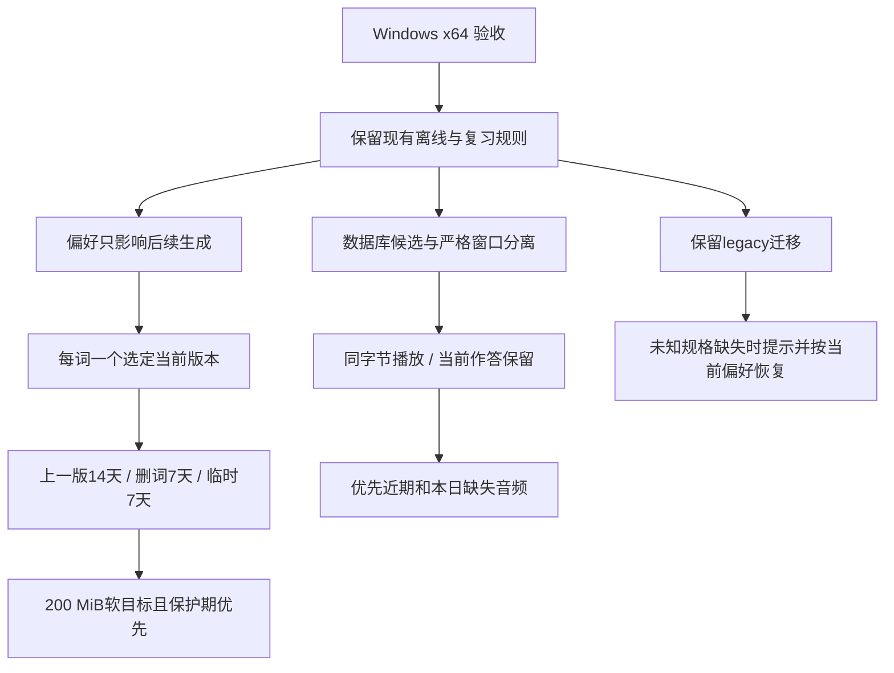

# #24 复习队列与音频资产优化方案

设计确认：2026-11-03；状态核对：2026-11-04。Q1–Q9已逐项确认，Q10已共同确认整份设计与测试基线。本文的设计目标继续有效；批量快照及部分选定版本已进入工作区，完整验收待完成，见[架构核对](evidence/issue-24/architecture-reconciliation-2026-11-04.md)。同步仍未实现。

## 目标与依据

采用“批量数据库候选读取 → 有界音频校验窗口 → 同一份字节解码播放 → 事务内评分”的链路。保留已有业务规则，先消除 SQL N+1 和全库文件检查，再依据实测决定索引投影、增量缓存和连接管理的实施深度。

本轮验收平台为 Windows x64。现有 macOS、Windows ARM64、macOS ARM64 与未来浏览器要求继续作为后续门槛；本轮不以 Windows 证据代替它们。应用继续离线运行，音频保留在 portable 数据目录。本次产物包括本方案、[测试计划](issue-24-test-plan.md)、[词汇表](../GLOSSARY.md)及已确认的 ADR [0007](adr/0007-windowed-audio-availability.md)/[0008](adr/0008-selected-word-audio-content-versions.md)。

参考稿 [new-design-draft.md](new-design-draft.md) 提供方向，本文按当前源码与访谈修正其前提。权威业务依据为 [产品基线](product.md)、[路线](roadmap.md)、[现有架构](architecture.md)、[M2 规格](m2-spec.md)、[M2 规则](m2-review-core.md) 和 ADR [0005](adr/0005-independent-progress-for-vocabulary-card-types.md)、[0006](adr/0006-learning-days-and-absolute-review-times.md)。2026-11-03 已通过 gh 只读复核 [GitHub #24](https://github.com/zardonc/lexique/issues/24) 正文、状态、标签与评论；工单仍 OPEN，14 项验收未勾选。范围和 Q3 等细化位置见 [GitHub 设计复核](evidence/issue-24/github-design-review.md)，未修改 GitHub。

S0–S6 聚焦本轮队列与音频资产优化；原工单的本页批量选择、两阶段建卡、自动触发表、V01–V06、T01–T12 和原有稳定性矩阵继续保留。专项 50 个用例不替代 #24 全工单验收，未来 F01–F05 仍按 M3／M4／M6 准入。

## 已确认的设计边界

| 问题 | 本轮决定 |
| --- | --- |
| Q1 平台 | Windows x64 是优化与实测验收目标，保留其他平台后续要求。 |
| Q2 声线 | 偏好影响以后生成；已有音频只有明确更换才切换，失败保留旧当前版本。 |
| Q3 校验 | 数据库状态筛候选；近期窗口严格安全读取，最终播放同一份校验字节；未展示坏卡补位，当前题面、答案和进度保留。 |
| Q4 升级 | 保留旧格式迁移/一次登记，将登记写入移出日常队列查询。 |
| Q5 永久保留 | 生词本中每词一个选定当前版本永久保留；归属属于生词，删卡不解除音频归属。 |
| Q6 自动生成 | 优先近期窗口及本日按额度可出卡的缺失音频；远期仅处理用户已有明确批量需求。积压到期卡优先于明日卡。 |
| Q7 宽限 | 每词最多一份上一版，从新版本切换成功起 14 天；删词从最后归属解除起 7 天；临时查询从生成完成起 7 天，不因查询/播放续期。再次替换可淘汰更早的上一版。 |
| Q8 容量 | 无归属音频 200 MiB 软目标；不打断有效保护期，不淘汰生词本中选定当前音频；受保护占用多时可超过目标。 |
| Q9 旧规格未知 | 缺失/损坏 legacy 可按当前偏好重生成，并提示原规格未知、输出可能不同；可用 legacy 不自动更换。已知新格式修复使用原规格，规格不再受支持则显式报错并要求升级。 |

设计树的产品分支已落实如下；窗口大小、连接数、批次大小和性能目标是下文的可调工程起点，整体确认覆盖这些实施建议。



## S0 冻结前的实现与性能基线（历史）

下表保存设计时 schema 11 的原实现，供同期前后对照，不描述当前 schema 12。当前批量快照、选定版本和剩余缺口以[架构核对](evidence/issue-24/architecture-reconciliation-2026-11-04.md)为入口；这些改动不自动满足后续窗口／增量／GC 验收。

| 主题 | 当前实现或证据 | 对优化的约束 |
| --- | --- | --- |
| 运行与存储 | Tauri / React / Rust 本地桌面，SQLite schema 11；`Lexique-data/data/lexique.sqlite3`，音频 `Lexique-data/temp/speech/`。单文件最多 10,000,000 字节，无总容量预算。 | 不增加服务端、账户、网络合成或云权限。 |
| 音频规格 | 已保存的 256 份样本约 8.8 KB、1.43 秒、目标 Ogg Opus 48 kbit/s；正常/慢速共用字节，慢速为 0.6 倍播放。合成未固定随机种子。 | 样本均值不代表所有词；语义键与内容哈希分离，不能假定同规格输出确定。 |
| 查询 | 桌面逐听音卡取 progress，逐词取最多 20 个 audio key，再逐 key 取 asset 并读文件；最多 16 个线程/连接。storage 随后又逐卡读 progress、逐准入卡读 position。 | prepared statement 没有消除查询次数；只减线程不足以解决。 |
| 队列写入 | `review::queue` 当前是立即写事务，会日切、补 position、间隙不足重编号。entries 是当天曾准入记录，非全库顺序。 | “纯读快照”需拆开这些写入；文件 I/O 不可进入写事务。 |
| 缺失音频 | 不进入可评分卡列表；QueueView 已返回 pending、错误及一个目标词 ID。不是当前序列化 1 万个缺失 ID。 | 新增聚合计数是接口完善，不能作为已存在的巨大 payload 问题。 |
| 合成主管 | CPU，单常驻模型、2 推理线程；2 后台 + 1 交互槽。最多 4 次，退避 2/8/20 秒，首次 claim 起 120 秒 deadline，单次执行 60 秒，启动 30 秒。 | 保留现有预算；排队等待、冷加载与推理服务时间分别计量。不得按刷新重置失败预算。 |
| 清理 | 新格式临时资源从生成完成起 7 天；归属保留已实现；启动及每 6 小时、每批最多 100 项，mark → delete → finish。 | 旧架构文档的访问续期/24 小时间隔是早期记录。上一版/删词宽限/软容量是本次新增设计。 |
| 数据模型 | `speech_assets` 仅记每个 semantic key 的一个 hash 和 pending hash；文件名已含 key/hash。owner 属于 vocabulary。当前取最近可读版本，无显式选定指针。 | 先明确当前绑定与不可变版本；不能仅加 per-voice 指针而改变产品行为。 |
| 评分与额度 | 新 20 / 复习 50 默认值；新默认同时受复习额度；跨日学习与长期复习计复习额度，日内重复不限额，首次成功评分才计数，撤销返还原影响。 | 修复两额度零时桌面漏掉日内听音卡的分支；不改共享核心排程。 |
| 离线与同步 | 已有本地离线链路；M4/M6 同步和浏览器持久化仍是设计。 | 当前版本保留支持离线；音频本地 GC 不等于多端已安全回收。 |
| 到期分布 | 无真实用户总体分布数据。 | 同时测平滑、批量导入、长时间停学积压、日切集中到期，不能只测均匀到期。 |

最新 [固定二进制实测](evidence/issue-24/followup-results.md) 是 **10,000 个词 / 20,000 张双卡**，全为可初次学习的新卡，8 KiB Ogg 头部 I/O fixture，返回 20 卡；不等同“10,000 张混合历史卡的真实解码测试”。

| 同机 RTSS 关闭 | 首次请求 ms | 后续请求 ms |
| --- | ---: | --- |
| 起始旧版，全到期 | 15,821.2 | 7,478.0 / 4,561.1 |
| 最新版，全到期 | 1,684.9 | 768.3 / 691.7 |
| 最新版，全未来 | 260.1 | 236.5 / 229.2 |

环境为 Ryzen 9 8945HS、32 GB、NTFS NVMe；没有清除 OS 文件缓存，三个样本不能称 p95。最新二进制 SHA-256 是 `57334356d84addf966e3a639d0fdb7cea38d936d96171f6f0f15fb46de8ed77b`。当前小样冷合成约 4.31–5.28 秒、热并发 P0 约 1.07–1.12 秒；没有外部按次付费，CPU、耗电与时间成本未统一折价。

历史“音频检查约 98.4%”来自 [旧测量代码](evidence/issue-24/review_performance.rs) 对文件 inspect 的包围计时，调用没有 SQLite connection；不能重解释为当前 N+1 SQL + I/O 的合计。最新原生矩阵没有分阶段计时，优化前先补 instrumentation。RTSSHooks64.dll 崩溃是独立问题，本方案不宣称修复它。

## 必须保持的不变量

1. 生词内容、卡片身份、主动暂停、独立进度、评分历史与撤销语义不因音频重试/清理/迁移而改变；同词两卡不暂缓彼此。
2. 新卡包括无 progress 行以及撤销回 New 的卡；不能用 INNER JOIN progress 或无条件 `due_at <= now` 把它们丢掉。
3. 日内学习不占额度，两个上限为 0 仍可出到期日内听音卡；只在成功评分事务中计额度。
4. 现有类别准入、过滤后混排、当天持久位置必须保持；“按 position/due 排序”不足以替代全部算法。
5. 每词选定音频只由初次可用、明确替换或已授权缺失修复切换；偏好修改、后台完成顺序与 GC 不自动另选声线。
6. 有选定绑定的当前内容版本受永久保护，包含其被标为 suspect 的情形；坏文件可修复，但不能因“非 ready”直接删掉仍有当前绑定的文件。
7. 音频 hash 对应实际字节；语义 key 对应完整规格。未知 legacy 不冒认模型、声线或生成时间。
8. 数据库 ready 是候选信息；安全读取、大小/格式/hash 检查和实际解码仍是播放门槛。指纹或文件名不能证明完整性。
9. 校验的字节就是交给播放器的字节；不在校验后按路径再读另一份。前端本次播放成功前禁评分。
10. 未展示的坏卡可补位；已展示卡保留当前作答。迟到响应、发布与无关队列事件不能错绑音频或覆盖作答。
11. 一次刷新不能为了补齐窗口无界扫描实际文件；全部 metadata-ready 但全坏必须进入有界降级。
12. 发布与 GC 可在各断点恢复；失败可见，不生成假成功。学习写入确认维持既有持久性要求。

## 目标数据关系与迁移

### 数据职责

保留 `SpeechSpec` / semantic key、任务预算、业务 owner 和现有 storage 注入边界。新增内容版本和词的选定绑定；新表名为建议，实现时按仓库惯例定名。

| 关系 | 关键字段/约束 | 含义 |
| --- | --- | --- |
| `speech_assets` | semantic_key PK、完整 spec、context | 合成需求的语义身份；现有兼容字段在所有调用迁移前保留。 |
| `speech_content_versions` | version_id PK，semantic_key 可空，content_hash，provenance，受控且唯一 locator，byte_len，生成/发布时间，validation_state，gc_state，指纹，orphan_protect_until | 不可变内容的发布实例；有效live实例可按key/hash幂等复用，已deleted/marked实例不复活。legacy保留登记词ID/hash，未知字段为空。 |
| `word_audio_selection` | vocabulary_id PK，selected_version_id FK 可空，selection_revision，desired_generation，目标 key/操作 | 每词至多一个当前版本；新请求递增 desired_generation，防旧请求晚到覆盖新选择。 |
| `word_audio_previous` | vocabulary_id PK、version_id FK、protect_until | 每词至多一个上一版。保护期从新版本成功切换的事务时刻起算。 |
| 发布 intent | intent_id、内容身份、目标词、期望 generation/旧 selection、阶段 | 可复用现有 pending 字段并扩展为可恢复 intent；恢复范围覆盖 failed/cancelled 中残留 intent。 |
| GC intent | version_id、mark_generation、reason、标记时间 | 明确删哪个版本；完成更新必须匹配这次标记，不能误改后来发布。 |

`validation_state` 至少区分 unverified、verified、suspect、missing、invalid；`gc_state` 独立区分 live、marked、deleted。任务 queued/running/failed 不是文件校验状态。verified 表示安全读和字节校验通过，**不代表所有目标平台已经验证可解码**；实际播放器解码失败需单独归因。

文件实例身份也不可复用：新发布使用带唯一version/发布代次的受管理名称（如s-{key}-{hash}-{version_id}.ogg）；现存s-{key}-{hash}.ogg仍按兼容locator读取。同hash在旧实例清理后再次生成，分配新version/locator；仅真实可读、无GC意图的live实例可复用。这样迟到的旧GC不能因key/hash恰好相同删掉重新发布的文件；删除前仍须版本标记检查与发布/删除目录锁。

同一版本有任一当前绑定就永久保护；上一版保护和删词保护取有效引用的最大期限。删词先原子移除绑定并写最后归属解除的宽限，再删除业务记录；目前没有该产品入口，新增入口时必须接入此事务。删卡不执行 detach。

启用新 selection 之前，旧 semantic-key GC、旧 pending-GC 恢复及兼容读取必须统一转交版本协议仲裁，不能保留两套删除权威。迁移中仍有旧 owner 而该词尚未完成选定初始化的内容受临时迁移保护；选择完成并原子建立当前/上一版关系后才解除这项保护。v11 retain/semantic owner 此后不能继续代表该规格所有内容版本的永久保护。迁移前已 marked 的版本先恢复/完成标记，不允许直接绑定为当前；迟到旧删除请求必须检查版本身份与新保护关系。S2 就完成此安全切换，S6 只补完整宽限/容量策略。

### 迁移分两条链路

- **结构迁移**：增量建表/字段，保留旧数据、JSON 和旧路径。校验完整 state 和已有标识，失败回滚且不提升 schema。高于可识别 schema 继续报错，不重建库。不得在迁移中重排历史到期时间或重算旧评分。
- **音频登记**：独立、可恢复、分块执行。新格式已知 key/hash 元数据可批量登记；当前绑定首次建立前严格读取一次，优先处理近期需要的词。每词记录初始化状态，完成后不再在常规读取里遍历最多 20 个变体。
- **legacy**：安全读取原 `{vocabulary_id}.ogg`，首次 hash 建立的是升级时基线。用同一份已校验字节写受管理的不可变兼容文件，验证后提交版本及选定绑定；原文件在成功提交之前保留。模型/声线/原生成时间保持 unknown。
- 旧流程实际可用的首选版本才成为首次选定版本，不能仅按最新时间绑定一个坏文件。可用 legacy 不因迁移更换；缺失/损坏按 Q9 处理。
- 旧库存在未登记的历史 `s-{key}-{hash}.ogg` 时，先与已知 key/intent 对应并登记；无法确认来源的文件保留为未知。升级过程先完成保护关系，清理候选随后产生；不因首次扫描立即删除旧文件。
- 迁移在后台分块让出执行权，听音迁移显示真实处理中状态，识义学习可继续。首卡相关迁移可优先；全库扫描不作为进入应用的阻塞门槛。

### 进度投影按收益决定

第一步不需要先改 JSON 结构：一次 LEFT JOIN 读 cards/progress/entries/paused/selected version，统一解析并复用位置 map。随后如 CPU 解码/全表候选仍占显著成本，再给现有 progress 添加 `phase/due_at/last_review_at` 可索引投影，保留完整 state/revision 为权威。

投影在评分、撤销、迁移回填及以后同步应用的**同一事务**维护。建卡仍可没有 progress，LEFT JOIN 缺行即 New/revision=0；撤销回 New 保留递增 revision。历史额度可另投影“本次是否消耗 new/review”，分类来自原 before_state、历史时区和学习日，不使用最新设置重解释。全量回填先独立比较，才让查询消费投影。

## 队列读取、排序与额度

### 最小批量读取

下例是第一阶段的查询形状，非可直接运行的迁移 SQL；音频新表需先建立。完整设置/已用额度/队列状态/候选来自同一个短读快照。

```sql
SELECT c.id, c.vocabulary_id, c.kind,
       p.revision, p.state, q.position,
       CASE WHEN paused.vocabulary_id IS NULL THEN 0 ELSE 1 END AS is_paused,
       selected.selected_version_id, selected.selection_revision,
       v.semantic_key, v.content_hash, v.validation_state, v.gc_state,
       v.byte_len, v.locator
FROM review_cards AS c
LEFT JOIN review_progress AS p ON p.card_id = c.id
LEFT JOIN review_queue_entries AS q ON q.card_id = c.id
LEFT JOIN review_paused AS paused ON paused.vocabulary_id = c.vocabulary_id
LEFT JOIN word_audio_selection AS selected ON selected.vocabulary_id = c.vocabulary_id
LEFT JOIN speech_content_versions AS v ON v.version_id = selected.selected_version_id
ORDER BY c.id;
```

文件读取函数接受此快照里的不可变版本元数据，不再查 word keys/asset。首次业务分类可以在 Rust 中流式处理批量行；这一阶段仍可能 O(N) 解析/排序，但消除 O(N) SQL 调用与全库文件读取，不夸称所有工作已变 O(1)。

投影完成后拆为 New、Learning/Relearning、Review 候选流，将暂停、到期、已知音频状态下推。New 分支明确包含缺 progress/NULL due。当前时区学习日与长期卡的稳定 FNV 顺序仍复用现有计算；该 hash 包含到期学习日和 card ID，不是一个固定 card_id 排序。

### 准入与持久顺序

- 使用原规则：先预留跨日学习，长期复习用剩余复习额度，新卡按“忽略复习上限”设置取可用额度；日内学习另一路不限额度。
- 长期候选按当前时区的到期学习日 + 现有 FNV + card ID 准入。新/长期混排比例用过滤后且额度裁剪后的实际数量，不用固定比例替代。
- `review_queue_entries` 只保存当天曾准入位置。已有 position 即使卡被暂时过滤也保留锚点；缺位卡按原算法插入；输出仍分钟学习优先，其余沿 position。
- 若候选改为分页，先确定各类别有效数量/准入边界，不能在混排前武断 `LIMIT 50`。完整 keyset 键包含类别、所需学习日/FNV、位置与唯一 ID，并绑定快照修订；NULL 单独分支。时区变更使派生日键失效，绝不改绝对 due。
- 位置延续 1,000,000 间隔、中点插入。间隙不足或接近整数上限则短事务重编号；保留现有先转入无冲突临时位置、再批量赋正值的策略。直接单 UPDATE ROW_NUMBER 可能撞即时 UNIQUE，不据草稿直接替换。

日切、首次缺位插入与重编号属于短写事务。快照计算结束后条件确认 queue revision 未变，再提交必要的顺序更新；若变化则有界重读。文件 I/O、合成和解码均在事务外。评分、撤销、暂停/恢复等命令提交后才发事件。

queue revision 覆盖有效进度/设置/暂停/卡片集合、当前 selection、当前版本 readiness 及持久位置改变；幂等 no-op 不递增。一次校验发现的失效状态可收集成一个 delta，在确认原快照 revision 后与基于该 delta 的位置更新一起提交，只递增一次；不将自身的 suspect 写回反复视为外部冲突。与另一写者冲突时保留有效的不可变字节缓存，有限重读/重新计算，超过预算返回处理中而非无限循环。

### 队列摘要与 IPC

返回固定上限的卡窗口，另给计数和进度字段，不能继续用 `cards.length` 冒充整个准入数量。

| 字段 | 定义 |
| --- | --- |
| `cards` | 对外可展示的小窗口（起点最多 W=4）；识义卡不需音频，听音卡已过严格字节检查，本次实际播放成功前仍不可评分。B=50 的 metadata 候选缓冲在服务内部，未校验候选不放进这个列表。 |
| `admitted_count` | 当前数据库状态、暂停/跳过/到期和额度规则下的准入数量；外部音频失效未被发现时可能偏高，UI 标明待校验状态。 |
| `pending_audio_count` | 当前到期、未暂停/未会话跳过且音频非就绪的听音卡数；不代表全部拥有剩余额度。 |
| `pending_audio_sample_ids` | 最多 100 个目标词 ID，按业务优先级；可用分页入口查看更多。 |
| `verification_pending` | 窗口正在校验/修复；与“无到期卡”“额度用尽”区分。 |
| `next_wake_at` | 下一次真正可能变化的到期/日切/重试时间，不为已失败任务安排无意义轮询。 |
| `queue_revision / learning_day / timezone` | 可观察快照身份，供丢弃迟到响应。 |
| 首卡 presentation | card ID/progress revision、选定版本 ID/hash、请求代次及读取结果，防音频错绑。 |

聚合计数可能仍扫描 DB 行；单独记录耗时，不与窗口 O(W) 混称常数开销。时区学习日排序需要 core 运算的部分可复用缓存，不能用 SQLite localtime 的固定日界替代 IANA 04:00/DST。

## 有界严格窗口与播放

工程起点：metadata 缓冲 B=50，严格窗口 W=4（当前+接下来 3 张），一次刷新最多 K=8 次实际文件 probe，校验并发 2，压缩字节常驻预算 32 MiB，请求等待预算起点 75 ms。参数经过实测再调整；10 MB 单文件上限与典型 9 KB 文件分开验收。

1. 从短数据库快照计算候选，识义卡无需文件门槛；听音卡拿明确版本元数据。
2. 安全目录能力句柄 + nofollow 文件打开，拒绝重解析点/越界，限制完整读长度；验证 Ogg 头、长度、SHA-256。指纹从实际句柄获得，不能先信路径 metadata。
3. verified byte buffer 缓存按不可变 version/hash 命中；将**该 buffer**交给 WebView 解码/播放。正常和慢速只改变 rate。
4. 未展示候选失败后，条件标记该版本 suspect/missing，提交去重修复需求，按新数据库状态补位；K 或等待预算耗尽返回“语音检查/修复进行中”，异步分块继续，不扫完 1 万个坏文件才响应。
5. 只有符合播放能力且确已损坏/缺失的错误自动修复。权限、重解析点、模型/codec 未准入、磁盘满保持可诊断，避免重复生成同样不能播放的音频。
6. 当前卡已经展示时保留题面、翻面状态和答案。失败期间提供重试/跳过；新音频到达后仍须本次成功播放才评分。已经播放的合法内存版本可完成当前作答，不被无关发布强制替换。

异步预算限制请求等待和工作量，不保证取消正在执行的 OS 阻塞 read；用固定 worker 池，迟到结果按代次丢弃，不以超时为由不断创建新线程。压缩缓存、IPC 拷贝、解码 PCM 和 Blob 分别计量；32 MiB 不是整个播放器内存承诺。预解码只做近期下一张，需单独确定最长允许时长/PCM 上限后启用。

当前 Windows 读句柄不允许 FILE_SHARE_DELETE，读中 GC 删除会失败重试；读完播放器已持有内存副本，整个播放过程不必长期持有磁盘 lease。将来改为路径/流式播放时再设计贯穿播放期的 lease。

评分仍由 transaction 时的业务资格与 expected progress revision 决定。presentation 记录/前端播放回执约束“本次卡/本次版本/本次请求”，不能被表述为密码学证明用户听见了音频；本方案不以恶意受控 renderer 为听觉证明威胁模型。无关 queue revision 变化不直接拒绝合法当前评分，暂停、时钟、额度、进度冲突等真实变化按既有错误处理。

## 发布、替换与修复协议

```text
捕获完整spec与desired_generation
  → 持久发布intent
  → 安全tmp写入 / sync / 不可变名称发布
  → 安全回读验证实际bytes
  → DB完成事务：登记version + 条件切换selection + 上一版保护
  → 提交后通知
```

- 保留当前 pending → 文件同步/rename → 回读 → 完成事务协议；补齐版本记录与 selection 更新。rename 不是整个跨文件/数据库操作的原子提交。
- worker 执行前比对持久 spec 与本次实际加载的模型资源、预处理、声线、步数、速度和编码。当前 worker 只传 text/voice，resident 固定其他参数；跨升级不能用新引擎输出冒用旧 semantic key。
- 新的选择意图递增 desired_generation；相同 operation 重试不递增，自动修复先按失效原因去重再分配代次。执行去重与选择意图区分：同 key 的多个有效需求可订阅同一次未取消执行；发布向仍有效的最新意图路由结果，不只验证最初发起者。
- 同 key 已进入取消/结束且不能承接新意图时，后继需求持久排队，前一执行结束后启动新 execute_generation。取消一个需求不取消仍有订阅者的共享执行。新的显式终态重试可以启动新执行预算，同一执行的自动退避、事件或幂等 operation 不能重置预算。
- 完成时匹配目标词、最新目标 generation、有效执行、未取消与期望旧 selection，才切换；晚完成的旧任务可登记内容但不能覆盖新选择。相同规格连续替换必须保证最新需求最终完成，不能只丢旧结果而漏掉后继任务。
- 明确替换失败/取消/DB 提交失败继续保留旧当前版本。成功切换才把旧当前放入上一版并启动 14 天；同 hash/同版本重复结果是幂等 no-op，不创建“上一版等于当前”。
- 已知现代版本的修复使用其原 spec；当前全局声线只用于新需求或 Q9 已授权的未知 legacy 修复。完整 spec 不支持则可见失败，不能静默升级。
- automatic repair 以“失效版本 + 错误原因/需求 generation”持久去重。每次刷新不重启 failed/cancelled；终态后需显式重试或新的真实需求，保留四次尝试/120 秒预算。
- 解码失败分为 bytes 确实无效与宿主能力不足。能力不足不把所有设备的同内容都判坏，也不无限重生成。
- 启动恢复查询全部未完成 intent，包含已 failed/cancelled 的任务；恢复使用与正常完成相同的目标词、最新 generation、有效执行、未取消及期望旧 selection 守卫。完整文件且守卫成立才完成提交；取消/过时代次仅登记未绑定内容并结束 intent，不能切换或假报成功。DB complete 后按操作身份幂等识别，重复恢复不重复切换/计期限。禁止只恢复 running tasks。

## 生命周期与容量

| 类别 | 保护条件 | 期限/淘汰 |
| --- | --- | --- |
| 生词选定当前 | 任意有效 selection 引用 | 永久；超过软目标也不淘汰。 |
| 上一版 | 仍是每词上一版、protect_until 未到 | 切换成功起 14 天；每词最多一份，再次替换释放更早版本的这项保护。 |
| 删词孤儿 | 最后当前归属解除 | 解除时起 7 天；多个保护条件取较晚期限。 |
| 临时词/未来例句 | 无当前/上一版/孤儿保护 | 生成完成起 7 天；软目标压力下可提前按 LRU 淘汰临时音频。 |
| 发布中/读中 | 有有效 intent 或系统读句柄占用 | 不与发布竞争删除；失败记账后重试。 |
| 来源未知文件 | 无可信登记/intent 对应 | 保留并报告，不靠文件名猜测后删除。 |

200 MiB = 209,715,200 字节软目标，统计无当前归属版本的逻辑占用；另显示实际分配占用、当前永久占用、保护期占用、可回收占用、tmp/intent 占用。文件系统块分配可能明显超过逻辑字节，指标分别提供。

清理顺序：已到期/释放多余版本 → 无保护临时 LRU → 若仍超过目标仅报告。临时读取可合并写 last_used 以支持 LRU，但不改变 expires_at，且不在队列只读事务写访问记录。永久版本与保护期不为“达标”牺牲；磁盘满保持旧版本和学习事务，报告实际音频写失败。

GC 重用每批最多 100 项的协议：
1. 短事务条件标记**具体版本**，再次检查不存在当前绑定、有效上一版/孤儿保护或发布 intent。
2. 事务外按指定 locator/key/hash 安全删除；读占用/权限失败保留 mark 和原因供重试。
3. 短事务按 version/mark_generation 条件完成；不存在文件按已删除处理，不能清掉后来新发布版本的记录。
4. 启动恢复 mark；绑定取得与 GC 标记使用同一状态条件。已过期或已 marked 的临时版本不能通过晚收藏复活，收藏提交正常缺失需求；不会出现“有 current 指针但允许 pending GC 删除”的状态。

当前版本不会作为 GC 候选，因此 GC 不需要自动挑“最近可用版本”替代当前。上一版恢复为显式操作；新当前文件失效可以修复同规格，保持现有选定声线。

## 主管优先级、队列缓存与并发

### 合成调度

保留独立交互槽、后台持久任务与现有资源边界。优先级建议为：
1. 当前播放/用户显式重试 P0。
2. 已验证窗口及后续少量候选的缺失修复。
3. 当日按额度可出卡需求，包含不受额度限制的日内学习。
4. 用户已提交的其他批量任务。

层内按现有业务序列/等待时间，semantic key 去重；同一个词的双卡不重复合成。“额度两倍≈150张”不作为固定常数。未到期任务不由日常刷新无限创建；已有用户批量需求继续完成。

为防持续交互或窗口变化饿死后台，后台采用等待老化/加权轮转；起点每 4 个窗口任务允许一个已排队本日/批量任务，P0 保留槽独立。若本日缺失尚未解决，不主动创建明日七天 horizon。比较 1/2/3 合成总并发的真实吞吐、P0 延迟、CPU/内存，证据不足前沿用 2 后台+1交互；不为吞吐挤占交互。

### 缓存与失效

先实现一个队列协调状态，沿用现有“一个查询在飞、事件合并、当前作答固定”边界；不为消除 N+1 先引入整个数据库的全局写 actor。

缓存保存 metadata 候选、类别计数/准入边界、已验证小窗口和 queue_revision。评分成功后更新本卡状态、移除旧位置、调整实际额度、登记新的学习到期；已到期分钟卡按既有规则补入。缓冲不足后台补充。允许小规模内存重新准入/混排，目标是避免每次评分重新读取全库与全部音频。

每次 delta/refill/rebuild 记录返回行数、JSON/投影解析数、重建次数与具体原因。连续普通评分应只做 delta/有限补充；固定一条全表查询仍然重扫全部行不能算增量通过。差分失败时可显式退回 DB-only 模式并报告 S5 未验收，不能在每次评分无声全库回退同时声称优化完成。

以下情形使缓存失效/重建：日切/时区或相关设置改变、暂停恢复/建卡/将来删词、会话跳过变化、时钟异常及休眠恢复、撤销、投影修订不匹配。音频事件只影响对应词/窗口；100–250 ms 合并普通发布事件，当前卡已就绪可立即处理。缓存增量若不能通过差分证明，回到 DB-only 重建，不输出未经确认的优化结果。

持久 queue revision 在影响队列的业务写事务内递增，缓存 delta 带前后 revision；任务与 UI 自有 request generation 另行区分。计算期间合并脏标记并至多尾随一次重算；旧响应丢弃，实际当前 presentation 保留。后续 full rebuild 仍可能 O(N)，不宣称几十毫秒已被证明。

### SQLite与线程选择

- 当前 Cargo 锁定 rusqlite 0.38.0 / bundled libsqlite3-sys 0.36.0；其 vendor 声明 SQLite 3.51.1。这是源码版本核对，未查询本轮运行二进制版本。
- 官方 WAL-reset 竞态修复门槛为 3.51.3+ 或明确回补 3.44.6/3.50.7。**新增 WAL/多连接并发 checkpoint 之前先升级或验证回补，记录实际 sqlite_version/source_id**。
- 若采用 WAL，统一连接工厂配置/回读 foreign_keys、busy_timeout、journal_mode、synchronous；学习数据维持 FULL 的已确认提交持久性，不采用 NORMAL 换取性能。读池初值 2，2/4 对照后定；固定 2 校验 worker 不持有 SQLite 连接。
- WAL 仍只有一个写者。优先短事务、明确条件写和 checkpoint 管理；只有测得写竞争无法通过这些手段解决，再引入统一写协调器。长读事务不可贯穿校验/合成/解码。
- WAL/SHM 位于同一 portable 用户库目录；一致备份与未来同步使用快照协议，不把正在写的 sqlite/WAL 当普通云文件复制。
- 现有 PK/UNIQUE 已提供的索引不重复添加。候选索引按最终查询验证：progress(phase,due_at,card_id)、版本 GC 状态/期限、selected/previous 的 version_id 反向引用。动态 now/绑定参数不可放进部分索引。
- EXPLAIN QUERY PLAN 用行为断言和访问量验证，不绑死特定打印字符串；temp_store、mmap、PRAGMA optimize 仅在测得收益后启用。

## 对账、完整性与跨端边界

威胁模型包含受管理音频的外部替换/截断、写入中断、磁盘损坏和路径重定向；信任当前应用的业务数据库及已准入资源清单。若同权限攻击者可同时改数据库预期 hash 和音频，本方案的 hash 对比不能提供来源认证，不承诺该额外模型。

启动先恢复关键发布/GC intent，再分块枚举对账（起点每批 200 项、每 6 小时维护周期）。枚举的缺失、大小/mtime 改变、重解析点可触发 suspect；同大小/mtime 替换仍由使用窗口的 SHA 检查发现。目录枚举不是实际句柄身份证明，Windows 文件 ID 也只作线索；portable 移动/换卷后按 hash 重新验证，不将正常移动当业务数据损坏。

低优先级完整 hash 巡检按维护预算逐步覆盖；不要求启动扫描完所有文件才学习，也不保证下一次使用前已发现所有坏文件。未知文件不删除，权限问题不假报完成；支持暂停维护并在下次恢复。

未来浏览器能力按实际宿主验证：Safari 18.4 已支持 Ogg Opus/Vorbis，系统为 macOS 15.4、iOS/iPadOS 18.4、visionOS 2.4。旧系统回退、最低系统与 WebKit/WASM 解码仍属 M6 门槛，本轮不引入解码依赖。未来音频共享采用不可变内容身份；远端设备引用/离线与确认规则未冻结前，本地 14/7 天 GC 不能当作跨设备安全删除协议。

## 指标、目标与实施顺序

### 可验证目标

| 指标 | 最终建议目标（均待实测） |
| --- | --- |
| 队列数据库查询次数 | 固定快照/聚合查询与分页调用；不再每词 progress/key/asset 查询。随页数可增，但不 O(N) 次独立 SQL。 |
| 严格窗口 I/O | 每刷新最多 K=8 probe；metadata 全缺失时为 0；旧已验证内存命中不再读盘。 |
| payload | cards<=W（起点4），服务内metadata缓冲<=B（起点50），缺失样例<=100；音频字节只发近期需要的版本，不把总候选/缺失 ID 全量发前端。 |
| 健康热缓存 10k 词/20k 卡进入复习 | 数据快照+窗口可展示首卡 p95<=100 ms；合成、迁移、解码资源首次加载和物理冷盘另列。 |
| 已预读且业务资格仍有效的切卡 | 评分成功返回后的 UI 下一卡展示 p95<=20 ms；从点击评分至持久提交/切卡的端到端另报，不用此数掩盖事务成本。 |
| 评分与合成争用 | 同报评分提交、P0 等待/服务/完成和后台吞吐；以保持交互相对退化为门槛，沿用已有预检预算后实测。 |
| 全坏降级 | 首次反馈受 K/等待预算限制；记录延迟、已验证进度和剩余待查。不能承诺立刻找到可播首卡。 |
| 50k 词压力 | 报扫描/聚合/重建/维护成本和内存趋势，先作为容量与扩展验证，不直接套用10k目标。 |

instrumentation 分离：SQLite 打开/锁等待、settings/usage、候选 SQL/返回行、JSON或投影解码、分类/排序/位置写、file open/read/hash、解码、IPC serialization、UI render、worker 排队/模型加载/推理/编码/发布、对账/GC。并行阶段单独记录 wall time 与累计 worker time，不把重叠累计值相加当端到端。

每个性能 case 至少 100 次稳态请求，保留原始样本与分位数算法，报告 p50/p95/max 与失败率；首次应用、首次模型、首次文件、OS cache 状态分别标记。对 1k/10k/50k、混合历史、音频缺失/坏文件和到期积压作受控矩阵，详细步骤见测试计划。编译与测量分离，后端及单项原生执行维持硬 60 秒。

### 可独立验收的批次

| 批次 | 交付与停止条件 |
| --- | --- |
| S0 现状/回归 | 分阶段计数、正确基线、双额度零听音回归红测；无 schema 改动。 |
| S1 最小批量化 | bulk LEFT JOIN/统一快照/位置 map，严格读与写事务分离；用既有算法保持顺序；先报告收益。 |
| S2 显式版本与兼容 | 增量版本/selection/intent，legacy一次登记、发布/恢复/保护谓词，当前音频不隐式切换；通过崩溃与GC竞争。 |
| S3 有界窗口与摘要 | 数据库 readiness + W/K/字节预算 + 同字节播放 + 错误去重修复 + 计数字段；全坏不会无界补位。 |
| S4 按瓶颈加深 | 若需要，再增进度/额度投影与索引；启用WAL前过SQLite版本/FULL/快照门槛，比较小读池与校验并发。 |
| S5 增量与优先级 | 缓存 delta、失效/日切/撤销回退、近期/本日生成优先与公平；差分和事件风暴通过。 |
| S6 生命周期闭环 | 上一版/删词宽限/200MiB、对账/低优先巡检、长时增长、portable重启与离线；记录实测及未达目标。 |

每批保持可恢复的权威事务链路，增量缓存可关闭回退；schema 升级不提供自动降级或重建。可以先 S1 获取收益，不把完整 actor/全局单写/投影一次性大改作为前置。实施时新增资源/依赖遵循[准入](development-readiness.md)，变更涉及学习数据/破坏迁移按 AGENTS 要求另行处理。

## 上游参考与交付状态

- [SQLite WAL](https://www.sqlite.org/wal.html) 与 [synchronous](https://www.sqlite.org/pragma.html#pragma_synchronous)：快照/单写者、checkpoint与掉电边界，以及 WAL-reset 修复门槛。
- [SQLite row values](https://www.sqlite.org/rowvalue.html#scrolling_window_queries)、[查询规划](https://www.sqlite.org/queryplanner.html)、[部分索引](https://www.sqlite.org/partialindex.html)：完整排序键、NULL与索引条件。
- [Anki 26.09.3 队列](https://github.com/ankitects/anki/blob/26.09.3/rslib/src/scheduler/queue/mod.rs) / [撤销](https://github.com/ankitects/anki/blob/26.09.3/rslib/src/scheduler/queue/undo.rs)：借鉴增量更新、代次与失效边界。其许可为 AGPL-3.0-or-later；本方案没有复制源码，Lexique维持MIT。
- [WebKit Safari 18.4](https://webkit.org/blog/16574/webkit-features-in-safari-18-4/)：2025-03-31发布的Ogg支持与系统门槛。
- 现状出处：[storage review](../crates/storage/src/review.rs)、[speech work](../crates/storage/src/speech_work.rs)、[migration 11](../crates/storage/migrations/0011_speech_work.sql)、[desktop vocabulary](../apps/desktop/src-tauri/src/vocabulary.rs)、[speech tasks](../apps/desktop/src-tauri/src/speech_tasks.rs)、[safe cache](../apps/desktop/src-tauri/src/speech_cache.rs)、[queue hook](../apps/desktop/src/use-review-queue.ts)。
- 历史音频样本：[TTS计量](evidence/tts-generation/gpu-cache.md)；既有集成证据：[followup](evidence/issue-24/followup-results.md)。这些证据不是本文拟议架构已经实现的证明。

本次验证范围仅文档差异、链接与内部一致性。测试计划里的新用例未执行，性能目标未达成/未测；未修改应用代码、依赖、用户库、音频或 GitHub，未扩大 docs/verification.md 的准备就绪声明。
