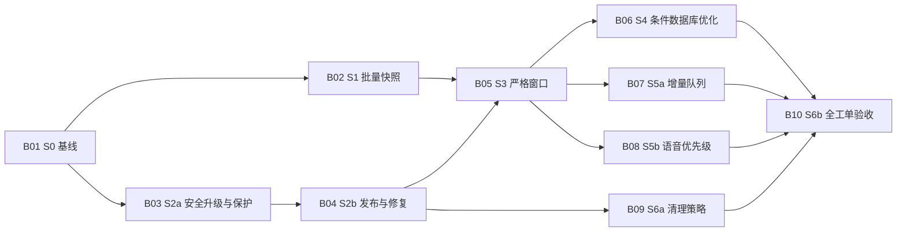

# #24 队列与选定音频优化的已发布子票图

当前实现与验收结果见[#24实施记录](evidence/issue-24/continuation-2026-11-04.md)和[逐项覆盖](evidence/issue-24/acceptance-matrix-2026-11-05.md)；用户于2026-11-05确认干净系统离线测试通过，#24本期验收完成。下文保留规格／发布阶段的计划与状态记录。

日期：2026-11-03（America/Vancouver）。状态：用户已确认10票／13边，子票#25–#34及全部原生关系已发布并回读。父票正文／标题／状态／标签未改，没有实施产品代码。

来源：[GitHub #24](https://github.com/zardonc/lexique/issues/24)与[正式规格](issue-24-spec.md)。发布前fresh gh回读确认正文与本地规格相同、OPEN、ready-for-agent、评论及原生子票均为空；发布后确认新增十票与十三边，父票内容保持。沿用Q1–Q10、ADR 0007／0008、[专项测试计划](issue-24-test-plan.md)及原R／V／T／F，不复用旧M2已完成票作为新的阻塞。

## 编号、粒度与阻塞图

B01–B10是规划内稳定标识，对应实际#25–#34。十票均为#24原生子票，ready-for-agent、OPEN且未分配；十三条native blocked-by已逐项回读。正文省略文字Blocked by节，实际关系及本地映射如下。

1. **B01／S0：复现队列与并发缺口，冻结隔离基线和资源预算**。阻塞：无。交付可重复的现状检查、阶段计数、独立参考结果、当前缺陷 red 与各后续契约的 fixture／屏障入口。
2. **B02／S1：批量读取复习快照并保持资格、额度和持久顺序**。阻塞：B01。交付真实 IPC 到复习页的批量读取链路及双额度零日内听音修复；此阶段保留原文件检查及原音频模型。
3. **B03／S2a：安全升级并选定现有单词音频，统一归属与删除保护**。阻塞：B01。交付旧库／音频升级后仍可播放、偏好不隐式换音频、删卡不解除保护；新旧读取／生成／GC统一版本身份。
4. **B04／S2b：按最新意图发布、更换与修复音频，恢复中断操作**。阻塞：B03。交付明确更换／修复及失败保留旧当前；同规格后继、取消／迟到、legacy修复与各发布断点恢复闭环。
5. **B05／S3：有界校验近期听音窗口并播放同一份字节**。阻塞：B02、B04。交付小窗口、候选摘要及全坏有界处理；安全完整校验后同字节播放，本次实播前禁评分、当前作答不丢。
6. **B06／S4：按实测瓶颈完善索引、投影及数据库并发门槛**。阻塞：B05。交付瓶颈处置结果；需要时端到端接入投影／索引／小读池，否则明确记录不引入的证据。WAL必须过版本及 FULL 门槛。
7. **B07／S5a：增量更新队列并保证自动触发和当前作答稳定**。阻塞：B05。交付连续评分有限更新、失效回退、完整自动触发、单查询及事件风暴／空闲零 I/O。不以 B06 的可选结构作为前置。
8. **B08／S5b：优先准备近期语音，保持批量提交、交互容量和公平恢复**。阻塞：B05。交付近期／本日优先、已提交远期继续、有界 CPU 主管及批量选择／任务接口回归；真实请求验证 P0、取消、预算及无在线外发。
9. **B09／S6a：落实音频保护期、软容量及安全清理恢复**。阻塞：B04。交付当前永久、上一版14天、最后归属7天、临时7天和200MiB软目标；访问拒过期、GC不误删、使用占用可恢复。与窗口／增量无业务前置关系，组合竞争在 B10验收。
10. **B10／S6b：完成 Windows 原生生命周期、性能与全工单验收**。阻塞：B06、B07、B08、B09。交付固定二进制的原生离线／移动／恢复、分片性能及 #24原14项完整状态；未测与未来集成不记通过，不关闭父票。

共 13 条直接阻塞边，已去除传递重复。初始 frontier 只有 B01；完成后 B02／B03均可开始。B06是需要明确处置结论的验证票，不是强制引入 WAL／投影的票。B10等待各分支结果，不把“性能未达”或产品缺口改写为已完成。

## 独立验收与保持可用

- S0是可独立复现／验收的验证交付，不改变产品行为；先建立现有缺陷红测，未来契约的红测在其所属子票改前执行。不得留下无归属的失败默认套件或伪造 red。
- S1继续使用现有音频路径，先消除 SQL／事务重复，不能偷偷启用尚未完成的版本模型。S2a可独立在原队列验证升级／播放；扩展结构与兼容同时成立后才接新读取／写入，旧 GC不能并存拥有删除权威。
- S2a就建立当前／上一版保护与版本级仲裁；S2b首次更换就必须保留上一版14天。S6a完善自动回收、孤儿／临时期限、容量及对账，不能被当作前面几票允许误删的理由。
- S3利用版本元数据直接校验，避免重新调用旧逐词key查询。S5a不依赖特定投影，可在保留原状态的快照上实现增量；S5b不依赖S5a的增量缓存，只依赖S3稳定窗口与需求信号。
- 各子票在自己的最高可用边界验证完整行为，含必要 schema／存储、平台／IPC、UI及测试；不为一张子票无故修改所有层。已有通过行为优先复用／加回归，缺口在所属子票修复，B10不接收没有归属的功能开发。
- 后端及每项原生执行硬60秒，预编译分开；真实SQLite／安全文件／解码播放与模拟IPC证据分列。当前工作区及用户库保留；不提交、推送或重写既有工作。

## 实际工单、正文与依赖

2026-11-04 回读：#25 已关闭，#26–#34 仍 OPEN。当前工作区已有批量快照和部分 schema 12 选定版本；正文中的“初始 frontier”描述发布时图状态，不要求重做 S0 或重新拆票。已接入口／未满足要求见[架构核对](evidence/issue-24/architecture-reconciliation-2026-11-04.md)，其余按下表依赖与实际验收推进。

| 标识 | GitHub | 本地正文 | Blocked by |
| --- | --- | --- | --- |
| B01 | [#25](https://github.com/zardonc/lexique/issues/25) | [S0 基线和资源预算](issue-24-tickets/01-s0-baseline.md) | 无 |
| B02 | [#26](https://github.com/zardonc/lexique/issues/26) | [S1 批量快照与规则](issue-24-tickets/02-s1-bulk-queue.md) | #25 |
| B03 | [#27](https://github.com/zardonc/lexique/issues/27) | [S2a 兼容升级与保护](issue-24-tickets/03-s2a-selected-audio.md) | #25 |
| B04 | [#28](https://github.com/zardonc/lexique/issues/28) | [S2b 发布与修复](issue-24-tickets/04-s2b-publication-recovery.md) | #27 |
| B05 | [#29](https://github.com/zardonc/lexique/issues/29) | [S3 严格窗口与播放](issue-24-tickets/05-s3-windowed-playback.md) | #26、#28 |
| B06 | [#30](https://github.com/zardonc/lexique/issues/30) | [S4 数据库性能处置](issue-24-tickets/06-s4-database-gates.md) | #29 |
| B07 | [#31](https://github.com/zardonc/lexique/issues/31) | [S5a 自动增量队列](issue-24-tickets/07-s5a-incremental-queue.md) | #29 |
| B08 | [#32](https://github.com/zardonc/lexique/issues/32) | [S5b 有界语音任务](issue-24-tickets/08-s5b-speech-priority.md) | #29 |
| B09 | [#33](https://github.com/zardonc/lexique/issues/33) | [S6a 保留与清理](issue-24-tickets/09-s6a-audio-lifecycle.md) | #28 |
| B10 | [#34](https://github.com/zardonc/lexique/issues/34) | [S6b 全工单验收](issue-24-tickets/10-s6b-native-acceptance.md) | #30、#31、#32、#33 |

## 范围与测试归属

| 原范围 | 主要功能／验收负责人 |
| --- | --- |
| R01／T01–T03 | B02业务资格；B05播放／presentation；B07自动触发／增量；B10组合验收。 |
| R02／T04 | B08本页选择、提交ID、逆序响应／非法载荷；B01现状记录，B10复核。 |
| R03／T06 | B08 CPU、P0、缓存／查词／笔记／评分并发及原生预算。 |
| R04／T05／T07 | B08短事务建卡／持久任务／取消／重启；B04发布意图恢复；B10组合验收。 |
| R05／T08／T09 | B03迁移、初选、永久保护；B04更换／修复；B09期限／容量／GC；B05安全同字节。 |
| R06／T10 | B08可控实际需求／预取契约；真实例句F01及网页F03 deferred。 |
| R07／T11 | B04已知／未知规格与发布错误；B08重试预算、无配置不外发；F02／F04 deferred。 |
| R08／F02–F04 | B10记录M4／M6准入与未验收，当前不造服务。 |
| R09／F05 | B10记录M4／M6可选共享边界，当前不造同步。 |
| R10／T12 | B01冻结原始预算；B02／B05／B06／B07／B08分别记录收益；B09增长／清理；B10同期完整矩阵。 |
| V01–V05 | B01建基线／fixture；各实现票在改前完成本票相关V验证；B10汇总，不把S0基线当所有新协议已验证。 |
| V06／F01–F05 | B10逐项里程碑、原因和状态，未准入不算passed。 |
| AC01–AC14 | B10逐项汇总所有负责票证据；发现剩余缺口回所属票修复，不因子票全关自动勾选。 |

专项测试主负责分配如下，跨票安全回归可重复执行，但不能以主分配省略本票影响的边界：

| 子票 | 主要 T24 用例 |
| --- | --- |
| B02 | Q01–Q07、Q10、C02、C04、C05 |
| B03 | G01、L01、L02、L05 |
| B04 | A06、W03、W04、W06、L03、L04 |
| B05 | Q08、Q09、A01–A05、A07、A08、P03 |
| B06 | C03、C06、P01；投影／WAL未采用时条件项说明不适用及证据。 |
| B07 | C01、P02 |
| B08 | W01、W02、W05；另承担原T04–T07、T10–T12相应产品边界。 |
| B09 | G02–G07 |
| B10 | P04、S01、S02、F01、F02；两专项F为后续平台项，不冒充原F01–F05集成通过。 |

50个专项用例均有主负责票；十二优先红回归分布在B02／B03／B04／B05／B07／B09，不要求S0在尚无协议时编造实现镜像。健康／已知缺失与独立oracle比完整最终顺序；未知全坏先有界安全、校验后最终收敛。

## 发布与验证结果

确认前完成文档结构、链接、覆盖和DAG检查；用户确认后逐票发布、链接#24、按实际数据库ID建立native关系。最终回读十票正文／标题／标签／状态、十个父子关系和十三边一致，父票标题／正文／状态／标签／评论保持，未执行父票edit／comment／close。详见[发布记录](evidence/issue-24/ticket-publication.md)。

当前frontier仅[#25／S0](https://github.com/zardonc/lexique/issues/25)，未开始实施或分配。#25完成后#26与#27均可开始；后续按实际closed blocker工作，不按仅创建／ready-for-agent误判已完成。

## 草案检查结果

2026-11-03，PowerShell检查退出码0：11份UTF-8文档／12个本地链接可读，10份正文符合Parent／What to build／Acceptance criteria／Blocked by模板，共83条验收，13条直接阻塞按拓扑顺序排列，无环／无传递重复，50个专项用例各有唯一主负责票。子票正文无具体文件路径／代码片段；新文件无索引diff空白检查通过。

上述为发布前草案检查记录。发布后本地十份正文仅移除草案声明及文字Blocked by节，与线上内容按换行规范化一致；实际依赖单独回读通过。未执行产品检查，父票保持现有正式规格；文档及发布验证不证明实现或性能完成。
