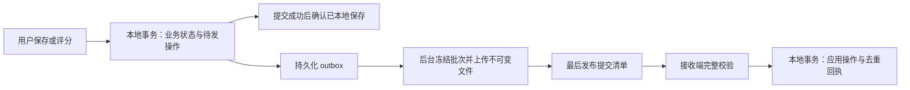

# 本地持久化与跨云文件同步设计评估

日期：2026-11-02。状态：后续设计建议与进入门槛，尚未实现。正式规格跟踪在 [#1](https://github.com/zardonc/lexique/issues/1)；阶段安排见[开发路线](roadmap.md)。本文继续遵循 [ADR 0001](adr/0001-separate-bundled-resources-from-learning-data.md)、[ADR 0004](adr/0004-one-vocabulary-record-with-reference-digest-and-notes.md)、[ADR 0005](adr/0005-independent-progress-for-vocabulary-card-types.md) 和 [ADR 0006](adr/0006-learning-days-and-absolute-review-times.md)。

2026-11-08 新增[系统选词／屏幕 OCR](translation-inputs.md)、[词频颜色](word-frequency-colors.md)和[WPM](speech-preferences.md)。原图、OCR 原文及整张词频资源／派生颜色不作为学习数据自动同步；只读资源与用户内容继续分离。WPM 仍是应用偏好，其跨设备共享范围在 M4 逐项冻结；本次未确认或实现 outbox／JSONL 协议。

## 结论与要求边界

推荐保留桌面端 SQLite，采用**版本化 JSON 清单 + 不可变 JSONL 快照和操作分段**作为交换协议。浏览器端由 IndexedDB 宿主持久化，WASM 继续负责同一纯调度核心；不要求为了文件格式把浏览器改为内存 SQLite。

本次用户明确要求应用是数据查看、编辑和冲突裁决的入口，文件协议可适配 Google Drive、OneDrive 等云存储，后台批量同步，不为每次保存或评分访问网盘，且已确认操作须在应用崩溃或强制关闭后恢复。这些目标替代较早的可人工编辑 Sheets 双向同步目标。SQLite + JSONL 是候选设计，具体协议、数值和服务接入顺序仍需相应阶段冻结。

原目录有三个主要问题：全局唯一文件名不能选出共同基线；覆盖或追加一个设备日志存在上传结果不明和并发写入窗口；“同步成功后清理”无法证明长期离线设备、删除标记与未解决冲突已经不再依赖旧数据。单一数据源指统一业务写入规则，多台应用仍是多个副本，当前客户端不能因此覆盖其他客户端。

## 同步范围、容量与格式

| 内容 | 建议处理 |
| --- | --- |
| 生词、逻辑引用、只读兜底摘要、独立笔记、共享例句 | 同步；词典缺失不能清空摘要或笔记；未来分类 / 语法记录按版本扩展 |
| 两类卡片、各自进度、暂停状态、评分与撤销历史 | 同步稳定身份、完整请求 / 结果、实际时间、时区、模型及设置版本；保留原始到期时间 |
| 调度设置与额度相关事件 | 保存设置变更和评分当时上下文；跨端额度设置、学习日及扣还合并规则须单独明确 |
| 正在显示的卡片、队列游标、临时跳过、UI 偏好 | 默认设备本地；接收进度后按业务规则重建队列，不覆盖另一端当前页面 |
| OAuth 凭据、私有服务设置、日志、词典与模型 | 不进入学习同步文件；凭据在各端重新授权 |
| 单词音频 | 不混入文本 oplog；可选媒体同步另设内容哈希、许可、容量与引用规则，沿用 [#24 补充研究](evidence/issue-24/concurrency-batch-web-research.md)，不改变已确认的本地保留政策 |

JSON 没有固定的“几行”上限，压成一行的完整 JSON 仍可能很大；JSONL 才约定一行一个 JSON 值。建议本协议仅接受有类型的对象，每行一个实体或事件，不把一词全部复习历史塞进一个巨大数组。笔记中的换行须转义。采用 UTF-8、无 BOM、固定输出换行和版本化字段；按[JSON Lines 约定](https://jsonlines.org/)处理，MIME 不依赖尚未标准化的 `application/jsonl`。

容量按 UTF-8 字节数判断。例如平均每条 **1 KiB** 时，1 万 / 10 万 / 100 万条约为 **9.8 / 97.7 / 976.6 MiB**，这是算术示例，未包含清单、压缩或实际字段开销，也不是性能测量。完整解析、重写和上传的成本随总字节数增长；JSONL 可以流式校验，分段增量只上传新增部分。日常查询依赖本地 SQLite / IndexedDB 索引，不每次扫描云端文件。

CSV 可表达扁平记录，但要完整恢复卡片、历史、关系和类型仍需多表与额外协议；XLSX 常需重写整个 ZIP 工作簿，外部编辑还可能改变类型与 ID。Excel 单表上限为 1,048,576 行、单格 32,767 字符，并有 15 位数字精度限制，见[官方限制](https://support.microsoft.com/en-us/office/excel-specifications-and-limits-1672b34d-7043-467e-8e27-269d656771c3)。它们适合作为应用生成的查看 / 交换副本，不作为自动同步基线。完整比较见[格式评估](sync-format-evaluation.md)。

## 已确认操作的本地持久化



桌面端须在**同一 SQLite 事务**中保存业务修改、跨端操作身份、设备序号与 durable outbox。只有事务提交成功才能确认用户操作。JSONL 是可重建的传输产物，不能先提交 SQLite 再另写 JSONL，或把 RAM 队列、文件追加成功当成第二个确认边界。初次启用同步时用一致快照纳入已有学习数据，再通过非破坏迁移接入后续写入；不凭空重建旧评分、重置卡片或删除历史。

应用崩溃与系统断电是不同故障等级。SQLite `synchronous=FULL` 在 WAL 下会同步每次事务提交；若选 WAL，须同时处理检查点、磁盘占用及平台文件系统条件，不能只开 WAL 就声明断电安全，见 [SQLite PRAGMA](https://www.sqlite.org/pragma.html#pragma_synchronous) 和 [WAL](https://www.sqlite.org/wal.html)。接入前核验所有业务连接的实际配置并运行故障测试；当前事务及 `busy_timeout` 的实现不等于已具备同步 outbox 或新的持久性验收。

后台任务持久化冻结的序号截止点、序列化字节 / 摘要、批次身份、供应商对象 ID / 上传会话及发布回执。上传时继续学习的新操作留在下一批。失败不回滚已保存学习；响应丢失后读取操作回执或以相同身份重试，不生成一个新的评分操作。接收操作的业务变化、冲突候选和去重回执也须原子提交，收到的操作不重新进入自己的发件箱。涉及多个实体的原子业务操作须保持一个可验证的操作或事务组，不在分段边界应用半个建卡 / 撤销。

WASM 不提供持久化。M6 建议在**同一 IndexedDB 数据库的一次事务**中提交业务状态、outbox、序号及回执，等待 `transaction.complete` 后确认；单条请求 `success` 不代表事务成功。网络访问和 WASM 计算不放进长期打开的 IndexedDB 事务；先准备数据，写入时重新检查业务修订前提。可请求 `durability: "strict"`，但它是浏览器提示，需检测支持及真实运行行为，不能承诺所有浏览器统一的断电保证，见 [transaction](https://developer.mozilla.org/en-US/docs/Web/API/IDBDatabase/transaction) 和 [durability](https://developer.mozilla.org/en-US/docs/Web/API/IDBTransaction/durability)。

同一浏览器的多标签页共享事务分配序号；单个 Worker / Web Locks 可减少重复调度，但不能替代事务与幂等。升级被旧标签页阻塞、事务中止、私密模式、配额耗尽或存储不可用时明确保留失败，不显示“已保存”。请求 [StorageManager.persist()](https://developer.mozilla.org/en-US/docs/Web/API/StorageManager/persist) 并展示能力；[浏览器清理 / 驱逐规则](https://developer.mozilla.org/en-US/docs/Web/API/Storage_API/Storage_quotas_and_eviction_criteria)仍由宿主控制，用户清除站点数据和设备损坏无法由本地事务阻止。换浏览器、profile 或部署 origin 是新本地副本，需要恢复和配对。

不依赖 `beforeunload`、关闭页面上传、定时器或仅在内存的 WASM 数据库保存已确认操作。浏览器后台可能被挂起，自动同步不承诺关闭页面后按时执行。无法保证目标宿主的本地持久化时，应标为临时预览并限制持久编辑承诺。强制关闭后的恢复保证适用于已完成持久事务；未提交草稿、浏览器主动删除存储以及设备损坏需另有恢复副本。

## 文件与身份协议

建议目录形态如下，具体字段属于 M4 待冻结协议：

```text
sync_folder/
├── dataset.json                          # 一次创建的身份与初始协议元数据
├── snapshots/<snapshot_id>.jsonl         # 不可变的一致检查点
├── oplogs/<replica_id>/<start>-<end>-<hash>.jsonl
├── commits/<commit_id>.json              # 文件齐备后发布的不可变提交清单
├── acks/<replica_id>/<checkpoint_id>-<ack_id>.json
└── archives/                             # 可选的不可变业务历史分区
```

`mac_tui` / `win_desktop` 只能作为显示名称；副本用持久随机身份区分。共享同一 SQLite 的 TUI / desktop 可以共享一个事务序号分配器，独立数据库则必须是不同副本。跨端身份不能直接使用现有本地整数主键或本地自增修订号，须保留映射。同步计数超过 JavaScript 安全整数范围时使用明确的十进制字符串编码；调度浮点数须无损往返且拒绝 NaN / Infinity。

| 元数据 | 必须明确的语义 |
| --- | --- |
| 数据集 / 协议 / epoch | 防止账号、目录或不同学习库混合；epoch 的变更须有已验证的成员与恢复规则 |
| 操作身份、replica、连续 seq | 每次已提交操作全局可识别；序号事务分配，不能因重启或恢复倒退 |
| 实体身份、generation、父修订 / 已观察 frontier | 识别因果依赖、并行分支及删除后重新创建，不能用文件时间代替 |
| 类型、payload、事务组 | 类型化业务变化，不传任意 SQL；评分包含原始请求、前后状态、时间 / 模型上下文，撤销引用目标事件 |
| 分段范围、条数、字节数及哈希 | 对封存的实际字节校验；重试复用原字节；同身份不同内容须报错隔离 |
| 提交清单、父提交、覆盖 frontier | 声明哪些完整对象组成批次 / 检查点；连续 frontier 只到无缺口的最大已应用序号 |

日志按副本、连续序号区间和批次封存，不让不同进程追加同一个云端文件。以未压缩 4 MiB 或 2,000 个操作作为分段压测起点，数值不是已确认上限；不得拆开原子业务组，超大单操作须显式处理而非截断。先采用顺序分段；哈希可以寻址与校验，**哈希分桶不减少总数据量，也不解决顺序或冲突**，只有测量证明列举 / 热目录成为瓶颈后才增加目录桶。大型快照可再分块并以清单绑定，压缩是可选封装层而非同步语义。

上传完所有被引用对象后才发布提交清单。接收端先校验版本、身份、大小、引用、完整条数和哈希，再在事务中应用。只收到清单、半文件或有序号缺口时保持“等待完整批次”，不能重放可解析的前几行或提前 ack。大型快照先写入隔离暂存区并完整验证，再原子切换，且保留同步期间新增 outbox；不先清空活动库。相同操作及摘要只生效一次，身份相同但内容不同按副本克隆 / 损坏处理，停止相关破坏性同步。

文件入口须限制单行 / 文件字节、JSON 深度、对象 / 引用数量及总解压体积，拒绝重复关键字段和非法数值；路径必须留在已选数据集目录，不跟随链接或 ZIP 路径逃逸。数据库 schema 与交换协议分别版本化；未知更高版本停止相关导入 / 发布，不能由旧客户端改写为旧格式。兼容迁移、成员最低版本与已封存字节的保留规则在 M4-S0 冻结，阈值按真实合法样例及故障输入验证。

所有文件都具有唯一 ID，并不意味着云端只能存在一个物理快照。逻辑基线须通过可信检查点祖先关系、覆盖 frontier 与数据完整性确定；文件名、修改时间和设备时钟均不能选主。初版建议一名指定压缩者发布检查点，其他副本仍独立发布操作。压缩者不可用时同步继续但暂停清理；多个检查点或成员变更出现分叉时保留分支并停止 GC，不能假定 Drive 和 OneDrive 都提供可靠的跨文件全局锁。

## 批量调度与故障恢复

建议可用前台 / 桌面后台任务以至少五分钟的自动间隔检查变化，叠加抖动和指数退避；这是待实测默认值。进入生词本、恢复网络或新增操作只标记需要同步并触发受限调度，不每次执行网络请求。提供“立即同步”，但合并重复触发并遵守服务限流。无待发数据不上传空批次；远端查询用分页、delta / changes 游标或条件读取，失效时低频完整重扫。

一次任务先获取并验证可见提交、合并到本地，再上传冻结的本地批次并发布清单，最后持久化发布状态与可证明的 ack。期间新收到或新产生的变化可留到下一轮。游标只是发现优化，不能替代协议 frontier；列举暂缺、事件乱序及扫描期间新增文件都要可恢复。状态分别表示“已本地保存 / 待上传 / 已发布本批次 / 等待完整文件 / 存在冲突”，不能把供应商上传成功表示成所有设备均已接收。

超时或结果不明时按保存的对象身份查询 / 重试并核对内容；不换名称创建第二份操作。429 / 服务故障遵守 Retry-After、有界重试与请求预算；授权失效保留 outbox，重新授权后续传。长期离线、磁盘或云盘配额耗尽时提供待发量与错误，不能丢弃队列换取“同步成功”；本地事务无法完成时拒绝新的成功确认。初次恢复、大量导入与历史补齐仍以有界批次处理，进度可中断并从回执恢复。

## 冲突与云端异常

| 场景 | 建议策略 |
| --- | --- |
| 不同记录独立修改，或有明确因果关系的后续修改 | 按依赖和实体前提应用；不同实体的自动并存不能破坏跨实体约束 |
| 两端同时改同一独立笔记 / 共享例句 | 保留共同基线及两端候选，在应用选择或手工合并；首版不自动文本合并。同记录的并行字段只有定义独立语义后才可放宽 |
| 同一卡片从相同父进度分别评分，或评分与撤销并发 | 保留全部事件及排程分支，暂停该卡继续评分并提示裁决；不按最新时间、较多次数或求和决定，不用当前时间 / 最新设置重新跑 FSRS |
| 同词的识义卡和听音卡分别学习 | 进度可独立会合；仍检查共享暂停、例句及额度关联，不把两卡合为一张 |
| 撤销目标已经有其他设备的后续评分 | 目标事件和父修订验证失败时保留冲突；不能直接恢复旧快照覆盖后续历史 |
| 删除与编辑 / 评分并发 | 保留删除标记、旧 generation 与修改候选；云文件消失不是业务删除。重新创建必须有新 generation，旧事件不能复活它 |
| 两端分别创建相同 NFC 标准词头 | 进入同词身份映射与内容 / 进度裁决，保持一份逻辑生词及每类型至多一张有效卡；保留候选、别名与全部历史，不自动复制或重置两卡 |
| 便携目录复制、数据库恢复导致 replica / seq 克隆 | 新的可写副本或回滚恢复必须分配新 replica；保留实体身份和待发操作来源，检测到序号 / 内容碰撞则停止相关同步 |

裁决本身是一个新的可同步操作，声明已看到的分支和采用的结果；不直接删除未选分支。首版可只对冲突实体暂停写入，其他记录继续学习和同步。额度事件及撤销影响必须与分支选择一致；多设备离线时不能严格执行一个即时全局每日上限，应保留真实已确认学习，不因会合后超额丢弃评分。各设备时区不同的学习日 / 额度归属是单独的 M4 / M6 门槛。

用户或其他程序直接编辑云文件属于**同步介质异常**。哈希错误、缺失文件、被改身份或未知格式应保留本地库 / outbox，把疑似内容隔离并提示通过应用检查、导入或修复。即使能解析也不自动视为应用操作，更不让当前客户端上传整库覆盖其他客户端。只有拥有可信原字节时才可发布经校验的修复对象；“以当前本地完整数据重建云端”需先显示其他分支、待同步操作与恢复副本，由用户明确选择，不能作为日常同步默认行为。

普通哈希只能证明相对可信清单的完整性；若外部程序同时改写数据与清单，哈希无法验证来源。若要求识别这种编辑，须在接入前选定数据集密钥 MAC 或设备签名，并落实配对、成员授权、凭据库 / 浏览器密钥、恢复与轮换。密钥不能放进同一云目录、公开源码、日志或前端构建。认证过的错误客户端操作仍可能产生业务冲突；来源认证也不等于端到端加密，后者另设隐私与恢复方案。

## 检查点、滚动与清理

检查点声明一致状态 S(F)，F 是各副本已覆盖的连续 frontier。生成时固定同一读视图及本地 outbox 截止点；视图含有的本地操作须在检查点提交前完整发布，或从已验证基线重建恰好到 F 的状态。不能导出正在变化的 SQLite，却把较早截止点写入快照。检查点包含实体身份、进度、删除屏障、未决分支、必要父修订、去重证明与历史 / 撤销引用。

不每次同步都滚动全量快照。达到可测的重放 / 体积阈值后再提出检查点，先发布、验证与确认，再清理。至少保留当前和上一份经验证的检查点及其依赖；还须保留上一检查点到当前检查点的增量链，才能在当前快照损坏时恢复到同一已覆盖状态。只留两个快照文件却删除中间日志不够。待确认候选未完成时可暂停再次生成全量快照，避免离线设备导致重复快照持续增加。

清理须同时满足：

1. 新检查点及引用对象完整发布，覆盖的操作可验证，恢复路径已经检查。
2. 当前 epoch 的相关活跃副本已**持久 ack / rebase**，没有序号缺口，也没有尚待发布、解决或迁移的旧基线依赖。ack 不能只表示下载文件。
3. 保留检查点、增量恢复链、未决冲突、业务历史和撤销不再引用待删对象。操作清理 frontier 不能高于最老保留恢复基线的覆盖范围。
4. 发布可信压缩 / 替代元数据，说明旧提交由哪一检查点覆盖；随后再删除对象。新客户端须能从可信锚点启动，不能仍把合法删除的旧日志当成缺失批次。
5. 只删除本数据集管理且已证明可回收的对象；失败可重试。过期提交、ack、缓存索引、上传残留也要受同一可达性规则管理，不能只清日志而让清单无限积累。

活跃设备长期离线会限制 GC。**无限期离线后任意回归、固定保留体积和完整自动恢复不能同时无条件保证。** 初版建议不自动按时间退役设备；用户可明确退役，经成员版本 / epoch 规则确认后允许清理。旧设备返回须先隔离待发操作，重新从当前检查点引导并裁决旧操作，不可强制清空本地或直接复用旧序号。旧删除标记只有在迟到写入被有效阻断、所有相关副本完成 rebase 后才可压缩为 generation / epoch 屏障。

本地 outbox 在持久化发布证明且保留恢复需要后可回收已发传输副本；未发布操作不能删除。**同步 oplog 清理不等于删除复习历史**。长期业务历史本身会增长，可另设不可变 JSONL 历史分区并由检查点引用，使新快照不反复复制全部旧历史；历史删减必须是独立的产品保留策略，不能借同步压缩删除学习数据。同步也会传播应用内删除，仍需独立备份 / 导出应对误删和云端损坏。

## 云存储兼容性与直接查看

| 目标 | 可复用部分 | 适配与限制 |
| --- | --- | --- |
| Google Drive API | 原样保存 JSON / JSONL / 压缩对象，使用同一协议 | 保存 file ID，不能以同名等于同一文件；预生成 ID 支持创建结果不明后的重试，已成功创建的重试会返回 409，须核对原对象；授权 scope、changes 与回调另验 |
| OneDrive / Microsoft Graph | 同一文件内容与操作语义 | 路径 / item ID、ETag、delta、上传会话及冲突策略独立实现；使用 fail / 条件检查，不默认替换或重命名已有对象；If-Match 不符返回 412，须检查是否相同已发布对象 |
| 桌面云盘客户端镜像目录 | 原则上可用同一不可变文件布局，无须逐行表格 API | 交付顺序、占位文件、延迟、冲突副本和云端完成状态不受应用控制；本地 rename 不等于远端原子发布，“已写同步目录”不能当“云端完成”。该模式需独立验收，浏览器不能默认访问桌面路径 |
| 其他文件 / 对象存储 | 版本化内容及独立提交语义可复用 | 新服务须实现授权、发现 / 分页、完整上传、下载校验与回收；不假定支持跨文件事务或统一锁 |

依据：[Drive 上传](https://developers.google.com/workspace/drive/api/guides/manage-uploads)、[Drive 创建文件](https://developers.google.com/workspace/drive/api/guides/create-file)、[OneDrive 上传会话](https://learn.microsoft.com/en-us/graph/api/driveitem-createuploadsession?view=graph-rest-1.0)。服务特有条件写入是辅助防线，不能成为所有提供商都有同样原子性的假设。账号 / 目录切换必须核对 dataset；初版建议每个数据集只有一个活动目标，跨云迁移先核验完整恢复再切换，不无条件双写两个云盘。

建议使用可见专用文件夹便于带走与换云；Drive `appDataFolder` 隐藏机制和 OneDrive app folder 的用户可修改性质不同，不能作为共同安全边界，见[格式评估](sync-format-evaluation.md)。预览依云服务、账户与文件类型而异，JSONL 没有通用业务查看器；即使能预览 JSON 文本也无法呈现卡片关系。应用提供按需 CSV / XLSX / PDF / Markdown 查看导出，注明生成时间，不自动回写这些文件。加密数据的明文查看导出须由用户明确发起。

## 使用场景与进入门槛

| 场景 | 范围与约束 |
| --- | --- |
| 单设备备份 / 恢复 | 可先交付一致、版本化快照及恢复检查；必须标为备份，不把整库覆盖扩展成多设备同步 |
| 多桌面离线修改 | 必须有 outbox、因果冲突、幂等、删除屏障和设备成员规则；云端编辑走异常处理 |
| 桌面 + 手机浏览器 | 同一协议与核心；IndexedDB、实际 WASM、OAuth / BFF、刷新 / 关闭恢复及多标签页分别验收 |
| 新设备已有本地数据 | 显式选择新数据集或合并导入，保留原库和同词候选；不默认用空云目录 / 空本地库覆盖另一端 |
| 长期离线、退役设备回归、便携复制 / 回滚 | 保留待发操作，身份重新配对与 rebase；无法证明安全时暂停相关应用 / 清理 |
| 大量导入与多年历史 | 流式校验、索引查询、分段上传、隔离暂存及可中断恢复；以实际字节、请求数、内存和重放时间压测 |

## 后续实施顺序

| 阶段 | 建议纵向交付 | 必须先解决 |
| --- | --- | --- |
| M4-S0 | 冻结跨云协议及故障样例，保持可读导出 | 共享范围、操作 / 同词身份、分支裁决、额度、来源认证、成员 / epoch 与恢复语义 |
| M4-S1 | 非破坏迁移 + 所有本地业务写入的事务 outbox + 禁网强关 / 重启恢复 | 实际 SQLite 配置、稳定重试身份、旧数据导出与完整性 |
| M4-S2 | 双副本文件协议：封存分段、清单、接收去重、冲突展示 | 乱序 / 缺口 / 半文件 / 重试 / 原子业务组；沿用真实操作及存储接缝 |
| M4-S3 | Google Drive 首条真实后台批量同步 | 测试账号、最小实际 scope、凭据库、OAuth、配额与错误恢复 |
| M4-S4 | OneDrive 适配同一协议 | 个人 / 工作学校账户及租户许可、会话 / ETag / delta 和冲突语义；独立运行证据 |
| M4-S5 | 检查点压缩、可验证 GC、设备退役及跨云迁移 / 恢复 | 相关 ack、上一恢复链、可信替代元数据、历史不丢失及清理失败重试 |
| M6-B1 | IndexedDB durable outbox + 实际 WASM 评分、关闭 / 重启、多标签页 | 浏览器基线、事务完成语义、配额 / 私密模式 / 升级 / origin 恢复 |
| M6-B2 | 浏览器与桌面会合、限频网络与部署 | OAuth / BFF / 会话 / CSRF / 访问控制、存储与离线承诺、跨端冲突及退役回归 |

这些是研究与拆票建议，不是本次实施命令。翻译 / AI 仍可与同步分开验收；M5 四目标发行门槛保持。可先验收单目标 / 单场景，但不能在第二适配器、GC 或浏览器宿主尚未验证时声明它们已支持。

## 必要验收场景

| 检查 | 预期可观察结果 |
| --- | --- |
| SQLite / IndexedDB 提交前失败，提交后确认并强关 | 失败不显示成功；已确认的业务和待发操作重启后均存在 |
| 确认后未到定时批次、上传中继续编辑 | 本地恢复完整；冻结批次不混入后续操作，下一轮可继续 |
| 业务提交或云创建成功但响应丢失，重复下载 / 重试 | 原操作仅生效一次，计数 / 卡片不重复，上传对象身份可恢复 |
| 半 JSONL、清单先到、日志缺口、未知高版本 | 不应用不完整状态、不越过缺口 ack、不清空或降级用户库 |
| 两端同笔记、同卡评分、撤销与评分并发 | 分歧可见且所有历史保留；裁决可同步，未决卡不继续错误排程 |
| 同词并发创建、两类卡独立学习、删除与编辑 | 同词 cardinality 与独立进度保留，删除不会由迟到旧事件复活 |
| 正常对象被编辑 / 删除、外部同时改清单、同步目录丢失 | 按冻结的来源认证策略隔离 / 报错；本地库及 outbox 保留，不整库覆盖 |
| 快照生成时持续学习 / 接收，两个压缩者分叉 | 快照恰好对应声明 frontier；分叉暂停 GC，后续操作仍可恢复 |
| 当前快照损坏、上一快照恢复、GC 中断 / 重试 | 上一基线及增量链可恢复同一已覆盖状态；业务历史与冲突不被误删 |
| 活跃设备数月离线、明确退役后带待发操作返回 | 无 ack 不越界清理；退役回归隔离、rebase 并保存待裁决操作 |
| 便携目录复制、数据库回滚、账号 / 云目标切换 | 副本身份 / 序号碰撞可见，不混库；切换后完整恢复可验证 |
| 浏览器多标签页、配额不足、私密模式、升级阻塞 | 序号原子分配；失败和能力限制真实可见，不以 RAM 伪装持久化 |
| 网络限流 / 授权失效 / 长离线 / 大量导入 | 有界后台批次、退避和可续传进度；不逐次评分访问网盘，不丢已确认操作 |
| 同一数据集在 Drive 与 OneDrive 分别往返 | 文件语义相同，供应商重试 / 发现 / 回收行为各有真实证据 |
| CSV / XLSX / PDF 查看导出被修改 | 原学习状态与自动同步不变；需要导入时通过应用校验和显式操作 |

验收使用非私人样例，记录字节数、操作量、峰值内存、重放耗时、网络请求数及缺口 / 冲突结果，不写未经测量的固定性能承诺。

## 资料与本次验证边界

[Joplin 同步规格](https://joplinapp.org/help/dev/spec/sync/)和[活跃 GitHub 项目](https://github.com/laurent22/joplin)可参考本地优先、同步状态与云服务驱动边界。其默认[源码许可](https://raw.githubusercontent.com/laurent22/joplin/dev/LICENSE)为 AGPL-3.0-or-later；本项目只参考公开设计，不复制不兼容代码。这里的封存分段、检查点清理及 FSRS 分支规则是 Lexique 的待验证设计，不能由 Joplin 的成熟度替代本项目证据。

本次沿用前段已完成的 Context7 / 一手文档核对，补查 JSON Lines 和 Excel 官方限制，并对照当前 RuntimeAdapter、SQLite 提交逻辑、领域规则与工单。文档检查和工单回读记录在[格式评估](sync-format-evaluation.md)。本次未接入 outbox、IndexedDB、云服务、加密或 GC，未修改数据库、清理云文件、运行应用测试或宣布新的运行 / 发行验收。
